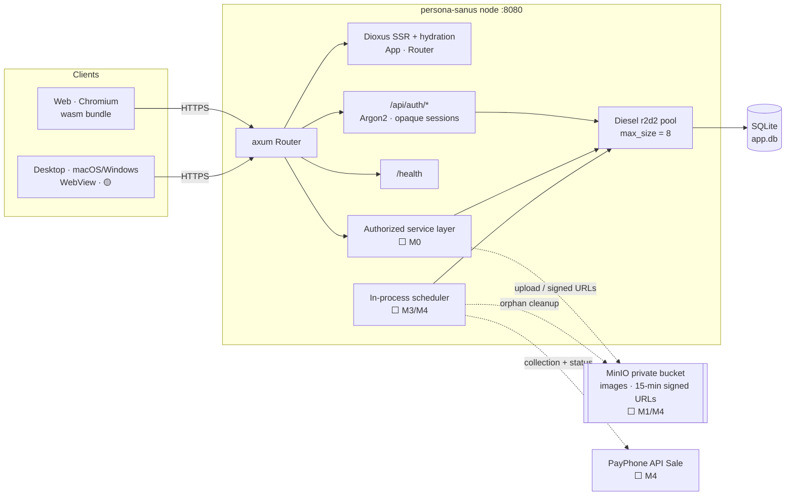
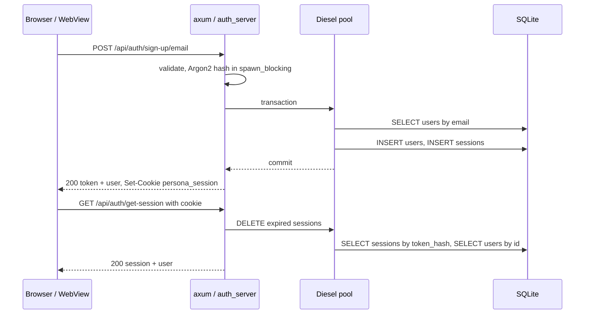
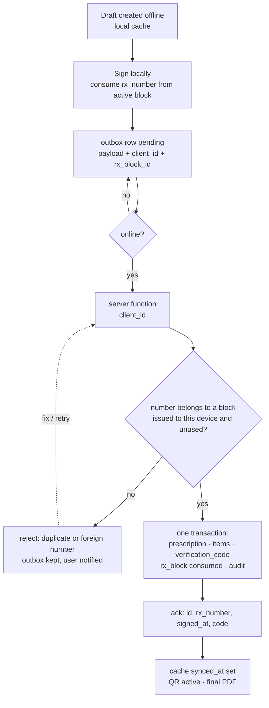
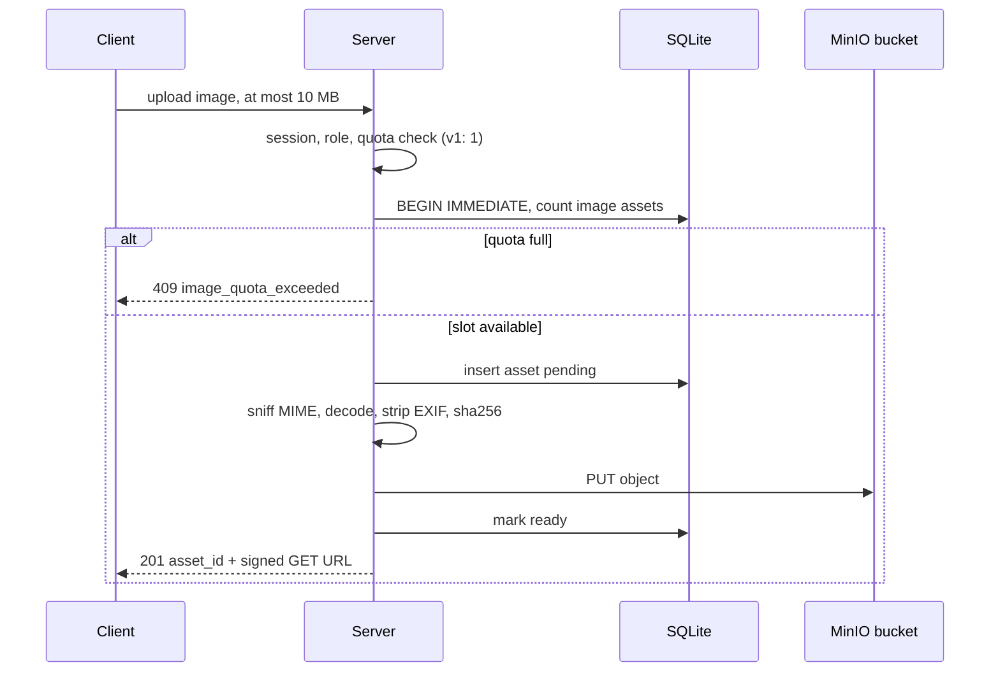
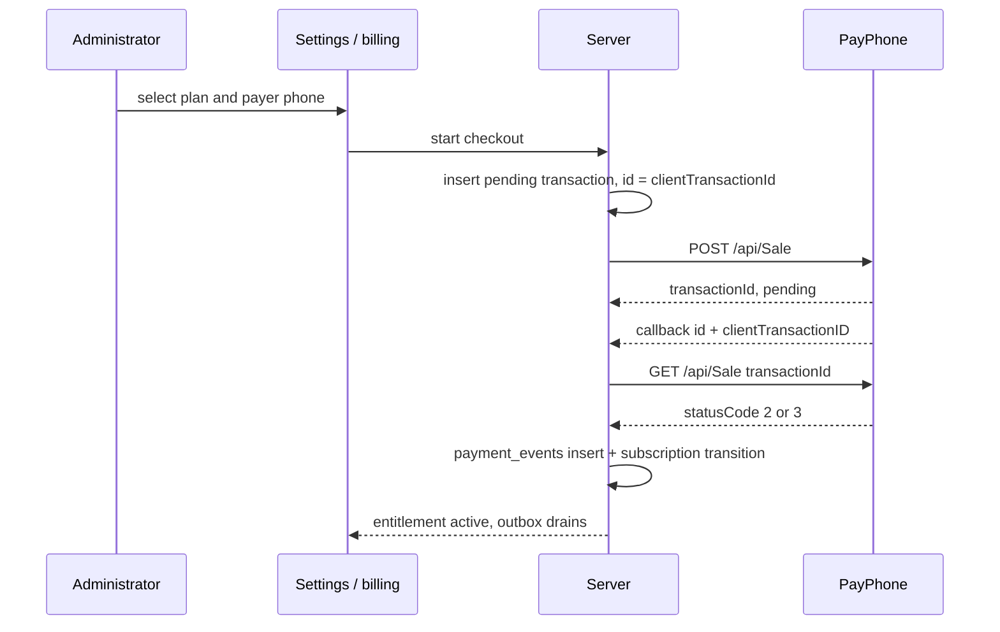

# PersonaSanus — Architecture

| Field | Value |
|---|---|
| Source | `context/PRD.md` (Draft v0.3 — 2026-11-11) §5.8, §7–§9, `context/database-design.md`, `context/sitemap.md` |
| Baseline | Working tree 2026-11-11 — M0 auth implemented on the Dioxus fullstack base |
| Runtime | Dioxus 0.7.1 requirement, locked 0.7.10 (`router`, `fullstack`) · axum 0.8 · Diesel 2.3 (`sqlite`, `r2d2`) · Argon2 0.6 |
| Topology | One fullstack node: server binary + wasm bundle; one SQLite file on local disk |
| Datastore | `app.db` locally · `/data/app.db` in Docker (`persona-data` volume) |
| Public surface | `:8080` — Dioxus pages, `/api/auth/*`, `/health`; `⬜ /verify/:code` |
| Build | `dx build --release --fullstack` → `target/dx/persona-sanus/release/web/{server,public}` |
| Status key | ✅ Implemented · 🟡 Partial · ⬜ Planned |

This document records how the PRD, sitemap, and database design are realized in the `persona-sanus` crate, and what is missing before v1. It adds no product scope.

## 1. System shape

The server process is the unit of deployment. There is no separate API service, message broker, or second clinical datastore. Every component that must be transactional with clinical data runs in the same process and writes the same SQLite file (PRD §7, DB §1).

| Area | Status | Evidence |
|---|---|---|
| Fullstack shell: SSR, hydration, assets, `/` `/login` `/dashboard` | ✅ | `src/main.rs`, `src/server.rs` |
| App-owned auth: sign-up, sign-in, get-session, sign-out | ✅ | `src/auth_server.rs`, `src/db.rs` |
| Session cookie, SHA-256 token storage, 30-day expiry | ✅ | `src/auth_server.rs` |
| SQLite pool + embedded migrations applied at boot | ✅ | `src/db.rs` |
| Auth schema (`users`, `sessions`) | ✅ | `migrations/20261111000000_create_auth` |
| App schema (`profiles`, `devices`, `assets`, clinical tables, `audit_log`, billing) | ⬜ | DB §5; no migration yet |
| Roles, clinic membership, server-side authorization | ⬜ | PRD §3, DB §2 |
| Patients, templates, prescriptions, items, verification | ⬜ | PRD §5.1–§5.6 |
| A4 PDF + QR | ⬜ | PRD §5.4 |
| Desktop cache + outbox + sync | ⬜ | PRD §5.5 |
| Billing + scheduler (v1.1) | ⬜ | PRD §5.7, D-04 |
| Image library (1 image in v1; MinIO, 15-min signed URLs) | ⬜ | PRD §5.8 |
| Branding asset upload (logo only) | ⬜ | PRD §5.3, §5.8, D-06 |
| Audit, MFA, rate limiting, backups | ⬜ | PRD §9, §11 M3 |



## 2. Compile-time split (Cargo features)

| Feature | Pulls in | Produces | Used by |
|---|---|---|---|
| `default = ["web", "server"]` | both below | fullstack dev/prod build | `dx serve`, Docker |
| `web` | `dioxus/web` | wasm client | browser |
| `server` | `dioxus/server`, `axum`, `tokio` (`macros`, `rt-multi-thread`, `net`), `diesel` (`sqlite`, `r2d2`), `diesel_migrations`, `libsqlite3-sys` (`bundled`), `argon2`, `sha2`, `hex`, `uuid` (`v4`, `v7`), `chrono` (`clock`) | native server binary | node |
| `desktop` | `dioxus/desktop` | native WebView app | macOS/Windows |
| `mobile` | `dioxus/mobile` | declared, not v1 | — |

`reqwest` and `serde_json` are unconditional and compile on both sides.

Rules:

- Server modules are gated in `src/main.rs`: `auth_server`, `db`, `schema`, and `server` only compile under `feature = "server"`. The non-server `main` launches `dioxus::launch(App)`; the server `main` is `#[tokio::main]`.
- Diesel, Argon2, and axum types must never appear in shared signatures. `SessionUser` is a plain struct in `src/auth.rs` precisely so the client can hold session state without pulling in the server stack.
- `libsqlite3-sys` uses `bundled`: SQLite is compiled with the crate, so the runtime image needs no system `libsqlite3`.
- `uuid` `v7` supplies sortable entity ids; `v4` supplies session-token entropy (DB §1).
- The Dockerfile consumes the fixed Dioxus output path; changing the build profile or crate layout requires updating it.

## 3. Module map

| Module | Side | Owns | Must not |
|---|---|---|---|
| `src/main.rs` | shared | `Route` enum, `App`, `Navbar`, `AuthPage`, `Dashboard`, server entry point | contain SQL, crypto, or HTTP handlers |
| `src/auth.rs` | client | auth HTTP calls, `SessionUser`, response parsing | import server modules |
| `src/auth_server.rs` | server | handlers, validation, Argon2, tokens, cookies, `with_conn` | build UI or HTML |
| `src/db.rs` | server | pool, embedded migrations, SQL, models | emit HTTP responses |
| `src/schema.rs` | server | Diesel `table!` definitions | drift from migrations |
| `src/server.rs` | server | axum composition, `AppState`, `/health` | query the database directly |
| `migrations/` | server | schema history | be edited after release |

Dependency direction: UI/`auth` → HTTP; `server` → `auth_server` → `db` → `schema`. No upward imports. Extend this seam rather than adding ad-hoc pools, routers, or SQL from handlers: `server::router` wires state, `auth_server` speaks HTTP, `db` is the only place with SQL.

Planned server components keep the same split rather than new top-level patterns:

| Component | Responsibility | Gate |
|---|---|---|
| Authorized service layer | mutations/reads with session, role, clinic membership, entitlement | every app write |
| Sync API | idempotent outbox drain, cache reconciliation, push channel | `can_sync` |
| Billing | PayPhone client, callback verification, entitlement transitions | administrator |
| Jobs | trial, renewal, polling, dunning, retention, session purge | server-only, single node |
| Assets | image library (5 active/past_due, 1 trialing/locked, 0 canceled, 10 MiB each), branding assets excluded, validation, quota, 15-min signed URLs | clinic state + Administrator/Doctor |
| Print view | one HTML/CSS A4 source for editor and PDF | shared UI |

## 4. Startup and request lifecycle

Boot order:

1. `dioxus::cli_config::fullstack_address_or_localhost()` resolves the bind address. Defaults are `127.0.0.1:8080`; `IP` and `PORT` override them (Compose sets `IP=0.0.0.0`).
2. `server::router` reads `PERSONA_COOKIE_SECURE` (`1` or case-insensitive `true`).
3. `db::connect` reads `DATABASE_URL` (default `sqlite://app.db`), creates the parent directory, and builds an r2d2 pool with `max_size = 8`.
4. Embedded migrations run on a pooled connection before any request is served; a migration failure aborts startup.
5. `AppState { pool, cookie_secure }` is built; auth routes take the state; `/health` returns `{"ok":true}`; the Dioxus app is mounted with `ServeConfig::new()`.
6. `axum::serve` uses `into_make_service_with_connect_info::<SocketAddr>()`, preserving the peer address for future rate limiting and audit.

Per request:

- axum extracts the payload; the handler validates it.
- All request database work goes through `with_conn`: `spawn_blocking` → `pool.get()` → `PRAGMA foreign_keys = ON` → closure. This is the only current path that enforces foreign keys. Password hashing and verification use separate `spawn_blocking` tasks because they do not need a connection.
- `AuthError` maps validation to `400`, duplicate email to `409`, bad credentials to `401`, and everything else to `500` with `{"message": …}`.
- `get_session` is a read that writes: it deletes expired sessions before looking up the token. Under sustained traffic that serializes a write per session check; move purging to the scheduler once sync traffic lands.

## 5. Identity, sessions, auth API

| Method | Path | Credential | Request | Response |
|---|---|---|---|---|
| `POST` | `/api/auth/sign-up/email` | none | `name`, `email`, `password` | `200 {token, user}` + `Set-Cookie`; `400` validation; `409` duplicate |
| `POST` | `/api/auth/sign-in/email` | none | `email`, `password` | `200 {token, user}` + `Set-Cookie`; `401` |
| `GET` | `/api/auth/get-session` | `persona_session` cookie | — | `200 {session, user}` or `null` |
| `POST` | `/api/auth/sign-out` | `persona_session` cookie | — | `200 {success:true}` + expired cookie |
| `GET` | `/health` | none | — | `200 {"ok":true}` |



Rules:

- Entity ids are UUID v7 text. Email is trimmed and lowercased before storage; the column is `UNIQUE COLLATE NOCASE`.
- Passwords require at least 8 characters and are hashed with Argon2 defaults. `user_json` omits `password_hash`; the hash never leaves the server.
- A session token is two concatenated UUID v4 values (64 hex characters). Only `SHA-256(token)` is stored, under a unique index, so a database leak yields no usable token.
- Sessions expire after 30 days. The cookie is `persona_session; Path=/; HttpOnly; SameSite=Lax; Max-Age=2592000`, plus `Secure` when `PERSONA_COOKIE_SECURE` is true.
- Sign-out deletes only the presented session. There is no all-device revocation, session rotation on password change, email verification, password reset, MFA, lockout, or rate limiting (M0; M3 in PRD §11).

Security findings in the current implementation:

| Finding | Evidence | Impact | Action |
|---|---|---|---|
| Token returned in the JSON body as well as the cookie | `session_response` | an XSS can read a credential that `HttpOnly` otherwise protects | return it only for a non-cookie transport |
| Account enumeration | sign-up returns `409`; sign-in skips Argon2 for unknown emails | email discovery and timing signal | uniform errors plus a dummy hash and rate limiting |
| No CSRF token or `Origin` check | cookie auth with JSON `POST` | `SameSite=Lax` mitigates, but lacks defense in depth | validate `Origin` on state-changing routes |
| No security headers or CORS layer | router composition | no CSP/HSTS surface; a browser-served second origin would fail without CORS | add `tower-http` when a second origin exists |

## 6. Data access contract

Storage conventions follow DB §1: UUID v7 `TEXT` ids, RFC3339 UTC timestamps, `YYYY-MM-DD` dates, `TEXT` + `CHECK` enums, integer cents for USD, and booleans as `INTEGER 0/1`.

Connection rules:

1. **Foreign keys.** SQLite requires `PRAGMA foreign_keys = ON` per connection. It is currently executed inside `auth_server::with_conn` on every checkout. Centralize it in an r2d2 connection customizer so no future query path can silently bypass it; the pool reuses connections, so a missed checkout is invisible until orphan rows appear.
2. **Concurrency.** No `journal_mode`, `busy_timeout`, or `synchronous` pragma is set. With a pool of 8 plus scheduled jobs, SQLite's default rollback journal can return `SQLITE_BUSY` and block readers during writes. Set WAL, a busy timeout, and a retry policy for write transactions before M2.
3. **Blocking work.** Diesel calls and Argon2 run in `spawn_blocking`. Never hold a pooled connection or a Dioxus signal lock across `.await`; `clippy.toml` already rejects the signal-lock case.
4. **Transactions.** Multi-row invariants belong in one transaction: sign-up (user + session), signing (counter, prescription, items, verification code, audit), payment resolution (event + transaction + subscription), and retention trim. Only sign-up is implemented today.
5. **Migrations.** Append-only and embedded. Planned order: `create_auth` ✅ → app schema ⬜ → billing ⬜ (DB §8). Update `src/schema.rs` in the same change as each migration; startup applies pending migrations before serving.
6. **Scoping.** Clinic and role filters belong in the service layer, never in client-supplied query parameters. The dashboard and route guards are not an authorization boundary.
7. **Assets.** Uploads reserve a `pending` row and count it against the v1 quota (1 library image per clinic) in a `BEGIN IMMEDIATE` transaction, then upload and mark it `ready`; failures delete the row and object. Deletion checks `template_version_assets` and retained prescriptions before touching the object. The 5/1/0 state quota and the cancellation purge are v1.1 (PRD §5.8, D-05).

Documentation drift: DB §9 attributes the foreign-key pragma to `src/db.rs`; the implemented location is `auth_server::with_conn`. This document follows the code; centralizing the pragma removes the ambiguity.

## 7. Client and route shell

`App` provides two context signals: `Option<SessionUser>` and a `checked` flag. A single `use_effect` calls `fetch_session` after mount. `Navbar` reads the session for sign-out; `Dashboard` redirects to `/login` with `navigator.replace` once the check completes and no session exists.

| Route | Layout | Guard | Status |
|---|---|---|---|
| `/` | `Navbar` | none | ✅ |
| `/login` | `Navbar` | none; signed-in users see their session | ✅ |
| `/dashboard` | `Navbar` | client-side redirect when signed out | ✅ |
| `/patients*`, `/prescriptions*`, `/templates*`, `/settings*`, `/audit`, `/verify/:code` | target shell | role- and session-dependent (sitemap §1.2) | ⬜ |

Rules and current limits:

- The `#[layout(Navbar)]` on `Home` is never closed with `#[end_layout]`, so `Navbar` wraps every route, including `/` and `/login`. The sitemap separates public routes from the authenticated shell; add `#[end_layout]` and a second layout group when the shell gains nav sections and sync indicators.
- The redirect is client-side only. SSR still renders the page shell for an unauthenticated request, and any future PHI load must be authorized inside a server function. Never rely on the redirect for data protection (PRD §3).
- The session fetch is a `use_effect`, so the first SSR paint is signed-out and flips after hydration. Data pages should use `use_server_future` so the server serializes the authorized result into the first render instead of duplicating a client fetch.
- UI code must copy signal values before awaiting. Holding `WriteLock` or `GenerationalRef` across `.await` is flagged by the `clippy.toml` configuration.
- No JavaScript interop exists yet. The rich-text editor (Tiptap/ProseMirror, PRD §7) will add it; it must emit sanitized structured JSON, never raw HTML.

Auth transport is the main client-side architectural defect:

| Runtime | Current behavior | Result | Required change |
|---|---|---|---|
| Web on the same host and port | absolute `http://127.0.0.1:8080/api/auth`; `fetch_credentials_include` | works only on the development machine | use a relative `/api/auth` base |
| Web behind TLS or a domain | absolute `http` loopback URL | mixed content or the wrong host | relative base |
| Desktop (native) | `reqwest` with the `json` feature; `with_credentials` is a no-op; no cookie store configured | the session cookie is neither stored nor sent, so auth cannot persist | server functions, or configurable origin + cookie jar/bearer |
| Remote desktop | loopback constant | calls the user's machine, not the server | configurable server origin |

Decision: use Dioxus server functions for application data and authorization; they are typed, same-origin, work on desktop, and keep the server authoritative. If the REST auth client remains, split the base URL (relative on wasm, configured origin on native), enable a cookie jar, and add credentialed CORS for the desktop origin. This must be resolved before shipping desktop or terminating TLS.

## 8. Target domains and their contracts

| Domain | Server contract | Stores | Gate | Status | PRD |
|---|---|---|---|---|---|
| Profile and membership | session → profile, role, clinic membership | `users`, `sessions`, `profiles`, `clinic_members` | session | 🟡 identity only | §3, DB §2 |
| Patients | CRUD, cédula dedupe, soft delete | `patients` | role + clinic | ⬜ | FR-001–003 |
| Templates | draft, publish immutable version, pin assets | `templates`, `template_versions`, `template_version_assets`, `assets` | doctor owner or administrator | ⬜ | FR-020–024 |
| Images | upload/delete, v1 quota (1), 15-min signed URLs, template pinning, placeholder rendering (v1.1) | `assets`, `template_version_assets` | role + quota | ⬜ | FR-080–085 |
| Prescriptions | draft→signed→superseded/voided, ordered items, block-allocated number | `prescriptions`, `prescription_items`, `rx_counters`, `rx_blocks` | doctor signs; nursing drafts; secretary reads | ⬜ | FR-010–014 |
| Verification | hashed code → public status, no PHI | `verification_codes` | public, rate limited | ⬜ | FR-050 |
| Audit | append-only actor/action/entity and sensitive reads | `audit_log` | administrator read | ⬜ | PRD §6 |
| Sync | idempotent mutations, block reconciliation, push | client cache + outbox | v1: none; v1.1: `can_sync` | ⬜ | FR-040–043 |
| Billing (v1.1) | plan, trial, subscription, transactions, events | billing tables (not in v1) | administrator | ⬜ v1.1 | FR-060–070 |

`users` is auth-owned. The app profile is `profiles`, linked by `auth_user_id`, because the two names collide in PRD §6 (DB §1). UI labels such as "Users" map to profiles plus `clinic_members`, not to the auth table.

## 9. Offline sync contract



Required server behavior:

- Every outbox row carries the client-generated id. A replay must return the existing record, not duplicate it.
- `prescriptions.client_id` is the only modeled idempotency key (DB §5). Patient create and template publish have no equivalent column, so a replay duplicates rows; an update is naturally idempotent when it carries the full state. Add a `client_id` (or request id) before M2, or make the server derive a stable key from the outbox payload.
- Drain oldest-first with `attempts`, `next_retry_at`, and a visible failure state. Never discard the outbox; a rejected row stays visible until resolved.
- Offline signing consumes the next number in the device's active `rx_blocks` row; on sync the server validates block ownership and non-reuse before accepting the write. Burned block tails remain gaps (D-02).
- v1 has no entitlement gate. v1.1 re-evaluates `can_sync` on every mutation; reads of retained data stay allowed, and `locked`/`canceled` reject writes with `402 sync_locked`.
- Server wins for signed data. Only an in-progress draft prompts for a conflict choice.
- Cache eviction applies only to server-backed rows older than `clinics.retention_days` (default 30). Rows with no server copy are never evicted.
- `pending_sync` is derived from the outbox, never a server column. Its PDF carries `PENDIENTE DE SINCRONIZACIÓN` and no active QR until the upload is reconciled.

Sync pushes over SSE from the existing axum router, with a 30-second polling fallback (PRD D-11). Do not add a second socket server.

## 10. Images and storage (1 image in v1; state-based in v1.1)

In v1 the library holds one 10 MB image per clinic; the clinic logo is a separate branding asset and does not count. The v1.1 billing entitlement restores the state-based library below: 5 images while `active` or `past_due`, 1 while `trialing` or `locked`, and 0 while `canceled`.

| Entitlement | Library uploads | Rendering |
|---|---|---|
| `trialing` | 1 | 1 library image + branding |
| `active` | 5 | all + branding |
| `past_due` within grace | 5 | 1 library image + branding; the rest show a placeholder |
| `locked` | 0 | 1 retained library image + branding |
| `canceled` | 0 | placeholders only; assets are soft-deleted |

| Rule | Value | Enforced at |
|---|---|---|
| Images per clinic | v1: 1; v1.1: 5 for `active`/`past_due`, 1 for `trialing`/`locked`, 0 for `canceled` (non-deleted `kind='image'` rows) | service transaction (count + insert) |
| Size per image | 10 MB (10,485,760 bytes) | stream cap + DB CHECK |
| Formats | JPEG, PNG (WebP and SVG rejected) | magic-byte sniff + decoder |
| Branding assets | logo only, excluded from the quota (no signature/stamp — D-06) | service |
| Storage key | `clinics/{clinic_id}/images/{asset_id}` | upload service |
| Access | private MinIO bucket; 15-minute signed GET URLs | bucket policy + signer |



Rules:

- v1 allows 1 library image per clinic; `active`/`past_due` (5), `trialing`/`locked` (1), and `canceled` (0) are the v1.1 gate. `locked`/`canceled` never accept uploads, and from `past_due` only the logo and one image render (v1.1).
- Uploads are server-proxied in v1: the 10 MiB cap, magic-byte MIME check, image decode, and EXIF/GPS strip happen before the object is marked `ready`. No presigned browser PUT.
- Reserve a `pending` row in a `BEGIN IMMEDIATE` transaction before the PUT, so the state quota cannot be raced. A failed upload deletes the row and object; a cleanup job removes `pending` rows older than one hour.
- The MinIO bucket is private, served only through 15-minute signed GET URLs. Object keys and URLs carry no PHI.
- Publishing a template writes `template_version_assets`. Deleting an image is blocked while any published version or retained prescription references it; delete the object last. The `canceled` soft-delete and object purge are v1.1 and leave pins intact with placeholder rendering (D-05).
- Offline rendering caches images pinned by published templates, verifies SHA-256, and caps the cache at 10 MiB in v1 (50 MiB once the v1.1 quota reaches 5). Never evict an image still referenced by a cached template.
- Uploads are online-only in v1: the desktop caches existing images but does not queue image files in the outbox.
- Upload and delete (including the cancellation purge) write `audit_log` rows (`asset_upload`, `asset_delete`) with metadata only.

## 11. PDF, QR, verification

Pipeline:

1. Load the pinned `template_versions.doc_json` plus the variable set (patient, doctor, clinic, prescription, medications).
2. Render one HTML/CSS document at 210×297 mm using the same markup and styles as the A4 preview.
3. Print to PDF from the platform print dialog (`window.print()` in Chromium/WebView → *Save as PDF*); no server renderer exists (D-01).
4. Add the QR encoding `https://<domain>/verify/{code}`, the readable verification code, prescription number, and issue date/time. No PHI in the QR or URL.
5. Name the file `{PatientName}-receta-{DD-MM-AAAA}-{DoctorName}.pdf`, sanitized and capped at 120 characters (FR-032).
6. Regeneration uses the pinned template version and items, never the current template, so a reprint reproduces the issued content (client-rendered, not byte-identical).

Constraints:

- One HTML/CSS source for editor and print. Fix fidelity in the print stylesheet, never with a second template (PRD §13).
- The runtime image (`debian:bookworm-slim`) has no Chromium and needs none: PDF generation is client-side (D-01). `request_pdf_regeneration` returns the pinned document for the client to print; it never renders a PDF.
- The public verification page will be unauthenticated and rate-limited. Its response is limited to status, doctor, date, and prescription number; "not found" means no matching `code_hash` row.

## 12. Billing and entitlement (v1.1 — not in v1)

**Not implemented in v1.** v1 ships with no billing tables, entitlement gate, or scheduler; retention dates live on `clinics` (`server_retention_until`, `data_grace_ends_at`). The design below is the v1.1 plan (PRD D-04).

- One subscription per clinic, created with the clinic. Trial and free-retention boundaries are set at creation and are not user-editable (FR-061).
- Plan amounts are seeded tax-inclusive; the IVA rate is effective-dated in `tax_rates`, and each transaction snapshots `tax_rate_bps`, `net_cents`, and `tax_cents` (DB §8). Later price or IVA changes never rewrite history.
- Checkout inserts a `payment_transactions` row whose UUID v7 is the PayPhone `clientTransactionId`, then calls `POST /api/Sale`. The callback is only a hint; the server confirms with `GET /api/Sale/{transactionId}` and records one `payment_events` row per resolved status (`event_hash` unique).
- `can_sync` is derived from status plus time, not a mutable flag. It allows `trialing` before `trial_ends_at` and `active`/`past_due` before the grace deadline. `locked` and `canceled` deny writes with `402 sync_locked`.
- Payment state never gates clinical work: patients, templates, editor, PDF/print, local history, already-issued QR verification, auth, and public verification remain available.
- One in-flight pending transaction per subscription. Approval happens in the PayPhone app within 5 minutes; failed renewals get a 7-day `past_due` grace with retries on days 0, +2, and +4 before `locked`.
- After a lapse, data beyond the free window is exportable for 30 days before the trim. The trim job is enabled after that window and never deletes the first 3 months; counsel sign-off remains a production prerequisite (PRD §9).
- The image library is state-based: `active` uploads 5 and renders all; `past_due` uploads 5 but renders 1; `trialing` uploads 1; `locked` uploads none but renders 1; `canceled` uploads none and soft-deletes assets.
- M4 checkout work is gated on PayPhone confirming in writing that API Sale has no recurring product.
- Same-day API Reverse is automated; later refunds are manual by the Administrator and audited (`payment_transactions.status='reversed'`).



## 13. Jobs and single-node operations

| Job | Trigger | Writes | Idempotency | Status |
|---|---|---|---|---|
| Asset cleanup | periodic | delete `pending` assets older than one hour and their objects | age + object key | ⬜ |
| Trial expiry (v1.1) | scheduler | `subscriptions` trialing→locked, audit | compare timestamps | ⬜ v1.1 |
| Renewal request (v1.1) | `next_charge_at` | pending transaction + PayPhone call | one pending per subscription | ⬜ v1.1 |
| Payment poll (v1.1) | every 60 s while pending | `payment_events`, activation | event hash + status | ⬜ v1.1 |
| Dunning (v1.1) | days 0/+2/+4, then lock | `past_due` → `locked` | status transitions | ⬜ v1.1 |
| Retention trim | after `data_grace_ends_at` | delete beyond the 3-month window | recompute deadline; flag-gated | ⬜ (off until counsel, D-09) |
| Session purge | periodic | delete expired sessions | by `expires_at` | 🟡 lazy on get-session |
| Backup | daily | encrypted SQLite copy | date-stamped | ⬜ ops |

Single-node invariant: in-process scheduler + SQLite + a filesystem volume means exactly one writer replica. Two replicas would split the database and could double-charge a clinic. Horizontal scaling requires an external database and job locking, which is out of v1 scope. Compose restarts the container (`unless-stopped`) and probes `/health` every 5 seconds; TLS must terminate outside the container and is not shipped in Compose.

## 14. Configuration

| Variable | Default | Scope | Notes |
|---|---|---|---|
| `DATABASE_URL` | `sqlite://app.db` | server | Compose uses `sqlite:///data/app.db` |
| `PERSONA_COOKIE_SECURE` | `false` | server | `1` or `true`; enable behind TLS |
| `IP` | `127.0.0.1` | server | Compose sets `0.0.0.0` |
| `PORT` | `8080` | server | Compose maps `8080:8080` |
| `PAYPHONE_TOKEN` | — | server | ⬜ v1.1 secret, never shipped to clients |
| `PAYPHONE_STORE_ID` | — | server | ⬜ v1.1 |
| `RETENTION_TRIM_ENABLED` | `false` | server | keep off until counsel sign-off (D-09) |
| `UPDATE_MANIFEST_URL` | — | desktop | signed auto-update manifest (D-08) |
| `ASSETS_BUCKET` | — | server | ⬜ private bucket name |
| `ASSETS_ENDPOINT` | — | server | ⬜ S3-compatible endpoint |
| `ASSETS_REGION` | — | server | ⬜ |
| `ASSETS_ACCESS_KEY_ID` | — | server | ⬜ secret, never shipped |
| `ASSETS_SECRET_ACCESS_KEY` | — | server | ⬜ secret, never shipped |
| `ASSETS_SIGNED_URL_TTL_SECONDS` | `900` | server | ⬜ 15-minute GET URLs |
| `AUTH_BASE` in `src/auth.rs` | `http://127.0.0.1:8080/api/auth` | client | ⚠️ hardcoded, not deployment-safe |

MinIO runs as a Compose service; `ASSETS_ENDPOINT` points at it and the bucket stays private. The LLM URL is per clinic in `clinics.llm_url_template` (DB §5), not a process environment variable. PRD FR-012 names `LLM_URL_TEMPLATE`; treat the column as the source of truth and seed it from configuration if an environment default is wanted.

## 15. Security boundaries

| Boundary | Control | Status |
|---|---|---|
| Image upload | magic-byte JPEG/PNG, decode limits, EXIF strip, private MinIO bucket, 15-min signed URLs, v1 quota 1 × 10 MB (v1.1: 5/1/0) | ⬜ |
| Browser ↔ node | TLS outside the container; `Secure` cookie flag | 🟡 flag configurable, TLS is external and absent from Compose |
| Session | `HttpOnly`, `SameSite=Lax`, SHA-256 token hash | ✅ |
| CSRF | `SameSite=Lax` + JSON handlers; no `Origin` check | 🟡 |
| Authorization | server-side clinic/role checks in the service layer | ⬜ |
| PHI minimization | no PHI in URLs, QR, logs, or provider payloads | 🟡 design only |
| PHI at rest | SQLite file and desktop cache; OS disk encryption required (D-07) | ⬜ ops |
| Secrets | PayPhone credentials in server environment (v1.1) | ⬜ |
| Audit | sensitive reads; billing transitions are v1.1 | ⬜ |
| Abuse controls | rate limits on auth and `/verify/:code`; PayPhone polling is v1.1 | ⬜ |
| Device control and MFA | `devices` modeled; revocation + MFA in M3 | ⬜ |

## 16. Invariants

| Invariant | Enforced at |
|---|---|
| Images: 1 per clinic in v1 (5 in v1.1, 0 canceled), ≤10 MiB each; logo excluded | service + DB CHECK (⬜) |
| Assets pinned by published versions are never deleted while referenced; the v1.1 cancellation purge soft-deletes and leaves pins | service + `template_version_assets` (⬜) |
| One node, one SQLite file; the desktop cache is a replica, not an authority | deployment + `db.rs` |
| The server authorizes; client guards are UX only | service layer (⬜) |
| Replayed client mutations are no-ops | `client_id` / request keys (⬜) |
| Signed prescriptions are immutable; only void/supersede transition them | service layer (⬜) |
| `rx_number` is unique and monotonically increasing per clinic, assigned from a server-issued block and validated on sync; burned tails are recorded gaps | transaction + partial unique index + `rx_blocks` (⬜) |
| Money is integer cents; transactions snapshot the plan amounts (v1.1) | schema + service layer (⬜) |
| PHI never appears in a URL, QR, log, or provider payload | service/output layer (⬜) |
| The outbox is never discarded; only server-backed cache rows expire | desktop cache (⬜) |
| Foreign keys are enabled per connection; blocking work stays off the reactor | `with_conn` ✅, pool customizer ⬜ |
| Migrations are append-only, embedded, and applied before serving | `db.rs` ✅ |

## 17. Risks and open decisions

| # | Risk | Evidence | Severity | Action |
|---|---|---|---|---|
| 1 | Auth client targets loopback and does not carry cookies on desktop | `src/auth.rs`, `with_credentials` | P0 | relative base + server functions before desktop/TLS |
| 2 | No server-side authorization; only a client redirect | `Dashboard` | P0 | authorize every read/write in the service layer before PHI pages |
| 3 | SQLite concurrency is unconfigured | no WAL or busy timeout; pool 8 | P1 | connection customizer + write retries |
| 4 | Sync push transport | ~~undefined~~ resolved | — | SSE + 30 s polling fallback (PRD D-11); no second socket server |
| 5 | Idempotency exists only for prescriptions | `prescriptions.client_id` | P1 | add keys for patients/templates before sync |
| 6 | PDF rendering location | ~~undecided~~ resolved | P1 | client print-to-PDF (PRD D-01); spike WKWebView/WebView2 print before M1 |
| 7 | Scheduler and SQLite assume one replica | in-process jobs | P1 | keep one node; document the scale-out prerequisites |
| 8 | Retention trim conflicts with health-record law | PRD §9 | P1 | `RETENTION_TRIM_ENABLED` off by default; counsel sign-off before production |
| 9 | Account enumeration and no auth rate limiting | auth handlers | P2 | uniform errors, dummy hash, limits in M3 |
| 10 | No backups or observability | no job/backup code, no tracing layer | P2 | daily encrypted backup, structured logs, metrics |
| 11 | Destructive initial migration drops legacy auth tables | `20261111000000_create_auth/up.sql` | P2 | document that pre-existing accounts must sign up again |
| 12 | `users` name collision resolved as `profiles` | DB §1 | P1 | apply the rename in the first app-schema migration |
| 13 | Image quota race or orphaned objects | upload path not built | P1 | `BEGIN IMMEDIATE`, pending cleanup, bucket lifecycle |
| 14 | Malicious/oversized image or EXIF/GPS leakage | upload path not built | P1 | magic-byte/decode limits, EXIF strip, reject WebP/SVG, 10 MiB cap |
| 15 | Bucket credentials or public object exposure | no storage config yet | P1 | private MinIO bucket, least privilege, 15-minute signed URLs |
| 16 | Image deletion or cancellation breaks an issued PDF | template pinning not implemented | P2 | reference checks in v1; v1.1 cancellation accepts placeholders (PRD D-05) |
| 17 | IVA changes misstate historical charges (v1.1) | `tax_rates` effective-dated | P2 | snapshot `tax_rate_bps`, `net_cents`, and `tax_cents` per transaction |
| 18 | Device revocation not enforceable until `sessions.device_id` lands | `devices` modeled, auth schema unchanged | P1 | add the nullable column in the auth migration before M3 |
| 19 | Preallocated numbering gaps or block exhaustion | `rx_blocks` not built | P1 | block allocation, server validation on sync, remaining-count UI before signing |
| 20 | Platform print API absent or unreliable in Dioxus desktop | no JS interop yet | P1 | spike WKWebView/WebView2 print before M1; `window.print()` fallback |
| 21 | Auto-update key compromise or bad release | no updater yet | P1 | signed manifest, key custody, staged rollout, rollback (PRD D-08) |

## 18. Verification

Repository policy is end-to-end and integration testing; unit tests are not required (AGENTS.md). Run these from the repository root; they use the existing blocks:

| Change | Gate |
|---|---|
| Compose build, boot, health, auth persistence | `persona-docker-verify` |
| Auth endpoints and public pages | `persona-probe --flow full` |
| Server reachability | `wait-health` |
| Schema design or migration SQL | `sqlite-schema-check` |
| Image upload, quota, signed URL | end-to-end probe; promote to a block when implemented |

```bash
python3 .blocks/persona-docker-verify.py --dir . --port 8080
python3 .blocks/persona-probe.py --base http://127.0.0.1:8080 --flow full
python3 .blocks/wait-health.py --url http://127.0.0.1:8080/health --expect 200 --timeout 60
python3 .blocks/sqlite-schema-check.py --path context/database-design.md --query "select name from sqlite_master where type = 'table' order by name"
```

`sqlite-schema-check` executes the DDL block in memory, so it validates the design before a migration exists; it does not inspect the live `app.db`.

## 19. Source-of-truth precedence and drift

When documents disagree, use this order:

| Topic | Authoritative source |
|---|---|
| Product behavior, roles, functional requirements | `PRD.md` |
| Tables, ids, retention, billing state | `database-design.md` |
| Routes and per-route roles | `sitemap.md` |
| What exists today | code + migrations |

Known drift to reconcile in implementation:

1. The database-design closing note says `src/db.rs` sets `PRAGMA foreign_keys`; the code does it in `auth_server::with_conn`.
2. FR-012 names an `LLM_URL_TEMPLATE` environment variable; the DB design stores `clinics.llm_url_template`. Use the column.
3. The sitemap places `/` and `/login` outside the authenticated shell; the current `Route` enum applies `Navbar` to all routes.
4. The PRD and sitemap treat `/dashboard` as session-guarded; the implemented guard is client-side only, with no server middleware.
5. The README documents the session cookie but not the `token` returned in the sign-up/sign-in body.
6. The database design describes the full app and billing schema; only the auth migration exists, and billing is v1.1.
7. PRD v0.4 (§14 decision log) supersedes earlier statements in this document and in the DB/sitemap about PDF rendering, billing scope, numbering, roles, image quota, and asset kinds; where they differ, the PRD decision log wins.
