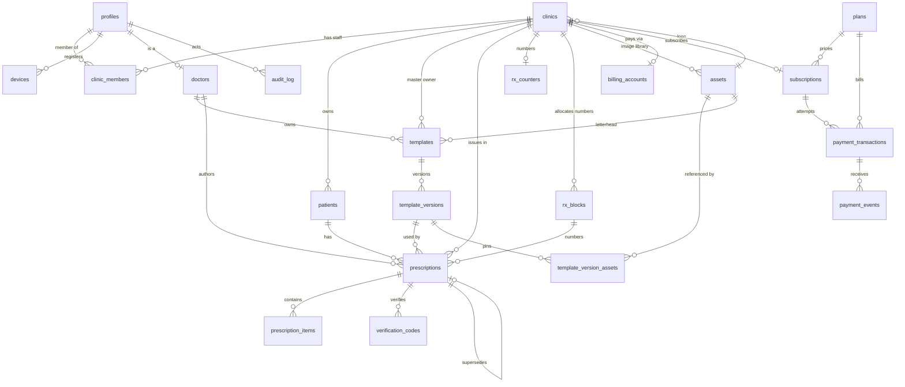

# PersonaSanus — Database Design

| Field | Value |
|---|---|
| Source | `context/PRD.md` (Draft v0.3 — 2026-11-11) §5.7/§5.8/§6, `context/sitemap.md` |
| Engine | SQLite (single node), accessed via Diesel 2.3 (`sqlite`, `r2d2`) |
| Server DB | `app.db` (local) / `/data/app.db` under Docker (`persona-data` volume) |
| Desktop DB | separate local cache SQLite + outbox queue |
| Identity | App-owned auth module: `users` (Argon2 password hash) and `sessions` (SHA-256 hashed opaque tokens), created by the initial Diesel migration |

## 1. Design decisions

| Decision | Choice | Rationale |
|---|---|---|
| App profile table name | **`profiles`**, not `users` | `users` belongs to the auth module (credentials + session owner). The PRD §6 `users` table **collides**; renamed to `profiles` and linked via `auth_user_id` → `users.id`. This is the one forced deviation from §6. |
| Entity IDs | `TEXT` UUID v7 (time-ordered) | Offline-first: the desktop must mint globally-unique ids without a server round-trip. Matches the auth module's `TEXT` ids. |
| Timestamps | `TEXT`, UTC ISO-8601/RFC3339 (`2026-11-11T12:34:56Z`) | Shared with the auth tables; sorts lexicographically for range queries (30-day retention, audit). |
| Dates only | `TEXT` `YYYY-MM-DD` | `patients.birth_date`. |
| Enums | `TEXT` + `CHECK` | SQLite has no enum type. |
| Booleans | `INTEGER 0/1` (none currently needed) | — |
| Foreign keys | enabled via `PRAGMA foreign_keys = ON` | **Required per connection** — the Diesel pool executes it before every auth query through `with_conn` in `src/auth_server.rs`. |
| Immutability | enforced in the authorized service layer | Signed/published prescriptions immutable; no DB triggers (PRD §3). The `canceled` asset purge never updates prescription rows. |
| PHI | never in URLs, QR, or `code` | `code` stored as `code_hash` only; plaintext exists only at creation. |
| Money | `INTEGER` cents, USD only | PayPhone expects integer cents (`$5 = 500`, `$50 = 5000`). No floats. Prices are tax-inclusive; the IVA rate lives in `tax_rates` (seeded 15%) and the net/tax split is computed at checkout, then snapshotted into `payment_transactions`. |
| Billing unit (v1.1) | one `subscriptions` row per `clinics` row | The clinic is the tenant; all members inherit sync entitlement. The Administrator pays. `clinic_id` is `UNIQUE`. |
| Billing provider (v1.1) | PayPhone API Sale, one-off per period | The API has no native recurring primitive; a scheduler creates a new `payment_transactions` row and collection request each period. v1.1 implementation is gated on PayPhone confirming this in writing. |
| Entitlement (v1.1) | derived, not a mutable flag | `can_sync(clinic_id)` = `trialing` OR `active` OR `past_due` within `grace_ends_at`; `locked`/`canceled` block server mutations. v1 has no gate. |
| Payment data | ids/status/amount only | No PAN/CVV/full card data; provider payload stored in `payment_events` for reconciliation. |
| Trial (v1.1) | one per clinic, not resettable | `trial_ends_at` and `free_retention_until` are set at clinic creation (+3 calendar months). v1 has no subscription row; retention dates live on `clinics` (PRD D-09). |
| Image library | 1 in v1 (free beta); v1.1: 5 while `active` or `past_due`, 1 while `trialing` or `locked`, 0 while `canceled`; ≤10 MiB each | Billing is per clinic. The v1 free beta caps the library at one image; the state tiers arrive with v1.1 (PRD D-04/D-10). |
| Branding assets | `kind='logo'` only, excluded from the library quota | No signature or stamp images exist: the doctor signs the printed prescription (PRD D-06). Logos render until the clinic is `canceled` (v1.1). |
| Image rendering (v1.1) | from `past_due` only the logo and one library image render; the rest show a placeholder | A lapsed clinic keeps its single free image and logo but cannot present the full library. `canceled` soft-deletes assets and renders placeholders. Not applicable in v1 (no billing states). |
| Asset storage | MinIO (Compose stack), private bucket, 15-minute signed URLs | No public objects; object keys carry no PHI; tenant-scoped counting requires `assets.clinic_id`. |
| Tax | `tax_rates` table, basis points, effective-dated | IVA is 15% today and may change; the rate is data, never a constant, and each transaction snapshots the rate it used. |
| Audit retention | 5 years, append-only | Matches the PRD §8 assumption; audit rows are never rewritten and no purge job runs before the window. |
| Refunds | same-day automatic API Reverse; later refunds manual by the Administrator | Matches PayPhone's same-day Reverse limit (FR-066); every refund writes an audit row and `status='reversed'`. |

## 2. Table overview

Auth module owns: `users` (`id`, `email`, `password_hash`, `display_name`, `created_at`, `updated_at`) and `sessions` (`id`, `token_hash`, `user_id`, `expires_at`, `created_at`, `device_id`). The initial Diesel migration drops the previous RustAuth `users`, `sessions`, `accounts`, and `verifications` tables and creates these two; `sessions.device_id` is nullable and added by a later auth migration once `devices` exists.

App-owned tables (this design):

| Table | Purpose | PRD ref |
|---|---|---|
| `profiles` | App profile (staff) extending the auth identity | §6 `users` (renamed) |
| `clinics` | Clinic settings, branding, retention | §6 `clinics` |
| `clinic_members` | Clinic ↔ staff membership + per-clinic role | §6 `clinic_members` |
| `devices` | Registered desktop installs + revocation | §9, PRD §9 |
| `doctors` | Doctor medical details (license, specialty, signature) | §6 `doctors` |
| `patients` | Patient demographics | §6 `patients` |
| `templates` | Template head record (per-doctor or clinic master) | §6 `templates` |
| `template_versions` | Immutable template versions + editor `doc_json` | §6 `template_versions` |
| `template_version_assets` | Pins referenced assets to immutable template versions | FR-024, §5.8 FR-080–085 |
| `prescriptions` | Prescription head + state machine | §6 `prescriptions` |
| `prescription_items` | Ordered medication lines | §6 `prescription_items` |
| `verification_codes` | Hashed verification code per signed prescription | §6 `verification_codes` |
| `audit_log` | Actor/action/entity trail + sensitive reads | §6 `audit_log` |
| `assets` | Clinic/doctor logos plus the image library, in private object storage | §7, FR-020/030, §5.8 FR-080–085 |
| `rx_counters` | Per-clinic highest allocated number (block allocation) | FR-014 |
| `rx_blocks` | Preallocated number blocks per device; consumed counts and burned tails | FR-014, D-02 |
| `tax_rates` | Effective-dated IVA rate; 15% seeded | §5.7, §9 |
| `plans` | Seeded plan catalog ($5 monthly, $50 yearly) | §5.7 FR-060 |
| `billing_accounts` | Payer identity + PayPhone phone per clinic | §5.7 FR-063 |
| `subscriptions` | Trial/paid state, periods, grace, retention deadline | §5.7 FR-061 |
| `payment_transactions` | One row per collection attempt; `id` = PayPhone `clientTransactionId` | §5.7 FR-063–065 |
| `payment_events` | Idempotent raw callback/poll payloads | §5.7 FR-064/068 |

The six billing tables (`tax_rates`, `plans`, `billing_accounts`, `subscriptions`, `payment_transactions`, `payment_events`) are v1.1-only. Desktop-local (not in server DB): `outbox`, `sync_meta`, `asset_cache`, plus cache mirrors of the clinical tables above. Billing/payment tables are server-only; the desktop caches only entitlement fields in `sync_meta` (v1.1).

## 3. Entity-relationship diagram



Auth relationship: `profiles.auth_user_id` → `users.id` (1:1). `sessions.device_id` → `devices.id` is intentionally not an FK in the auth migration; the app validates the device on session load.

## 4. Enumerated values

| Field | Values |
|---|---|
| `clinic_members.role` | `administrator`, `doctor`, `nursing`, `secretary` |
| `profiles.status` | `active`, `disabled` |
| `patients.sex` | `male`, `female`, `other`, `unspecified` |
| `templates.owner_type` | `doctor`, `clinic` |
| `templates.status`, `template_versions.status` | `draft`, `published`, `archived` |
| `prescriptions.status` | `draft`, `signed`, `superseded`, `voided` |
| `verification_codes.status` | `valid`, `voided`, `superseded` |
| `assets.kind` | `logo`, `image` (no signature/stamp — D-06) |
| `assets.status` | `pending`, `ready` |
| `assets.content_type` | `image/jpeg`, `image/png` |
| `devices.platform` | `macos`, `windows`, `web` |
| `outbox.operation` | `create_patient`, `update_patient`, `create_template`, `publish_template_version`, `create_prescription`, `upsert_prescription_item`, `sign_prescription`, `void_prescription`, `supersede_prescription`, `create_verification_code` |
| `outbox.status` | `pending`, `failed` |
| `tax_rates.name` | `IVA` |
| `plans.code` | `monthly`, `yearly` |
| `subscriptions.status` | `trialing`, `active`, `past_due`, `locked`, `canceled` |
| `payment_transactions.status` | `pending`, `approved`, `canceled`, `failed`, `reversed` |
| `payment_transactions.status_code` | `1` pending, `2` canceled/rejected, `3` approved (PayPhone); `NULL` before response |
| `payment_events.provider` | `payphone` |

The `tax_rates`, `plans`, `subscriptions`, `payment_transactions`, and `payment_events` enumerations are v1.1-only. Tax rates are stored as basis points: `1500` = 15.00%. The applicable rate is the latest `tax_rates` row whose `effective_from <= now`.

State machine (FR-013): `draft → signed → superseded/voided`. Signing locks editing; a correction sets the old record to `superseded` and creates a new record with `supersedes_id` → old `id`. Voiding requires `void_reason`.

## 5. Schema (SQLite DDL)

```sql
PRAGMA foreign_keys = ON;

CREATE TABLE profiles (
  id           TEXT PRIMARY KEY,                                      -- UUID v7
  auth_user_id TEXT NOT NULL UNIQUE,                                  -- -> users.id
  display_name TEXT NOT NULL,
  status       TEXT NOT NULL DEFAULT 'active' CHECK (status IN ('active','disabled')),
  created_at   TEXT NOT NULL,
  updated_at   TEXT NOT NULL,
  created_by   TEXT REFERENCES profiles(id)                           -- NULL for bootstrap admin
);

CREATE TABLE assets (
  id            TEXT PRIMARY KEY,
  clinic_id     TEXT NOT NULL REFERENCES clinics(id) ON DELETE CASCADE,
  object_key    TEXT NOT NULL UNIQUE,
  owner_type    TEXT NOT NULL CHECK (owner_type IN ('doctor','clinic')),
  owner_id      TEXT NOT NULL,
  kind          TEXT NOT NULL DEFAULT 'image' CHECK (kind IN ('logo','image')),
  original_name TEXT,
  content_type  TEXT NOT NULL CHECK (content_type IN ('image/jpeg','image/png')),
  size_bytes    INTEGER NOT NULL CHECK (size_bytes > 0 AND size_bytes <= 10485760),
  sha256        TEXT NOT NULL,
  width         INTEGER CHECK (width IS NULL OR width > 0),
  height        INTEGER CHECK (height IS NULL OR height > 0),
  status        TEXT NOT NULL DEFAULT 'pending' CHECK (status IN ('pending','ready')),
  deleted_at    TEXT,
  created_at    TEXT NOT NULL,
  updated_at    TEXT NOT NULL,
  created_by    TEXT REFERENCES profiles(id)
);
CREATE INDEX idx_assets_clinic_kind ON assets (clinic_id, kind, deleted_at);
CREATE INDEX idx_assets_owner ON assets (owner_type, owner_id);

CREATE TABLE clinics (
  id               TEXT PRIMARY KEY,
  name             TEXT NOT NULL,
  address          TEXT,
  phone            TEXT,
  logo_asset_id    TEXT REFERENCES assets(id),
  timezone         TEXT NOT NULL DEFAULT 'America/Guayaquil',
  llm_url_template TEXT,                                              -- e.g. https://chat.openai.com/?q={med}
  retention_days   INTEGER NOT NULL DEFAULT 30,
  server_retention_until TEXT NOT NULL,                               -- creation + 3 calendar months (D-09)
  data_grace_ends_at     TEXT,                                        -- export deadline after the window
  created_at       TEXT NOT NULL,
  updated_at       TEXT NOT NULL,
  created_by       TEXT REFERENCES profiles(id)
);

CREATE TABLE clinic_members (
  clinic_id  TEXT NOT NULL REFERENCES clinics(id) ON DELETE CASCADE,
  user_id    TEXT NOT NULL REFERENCES profiles(id) ON DELETE CASCADE,
  role       TEXT NOT NULL CHECK (role IN ('administrator','doctor','nursing','secretary')),
  created_at TEXT NOT NULL,
  updated_at TEXT NOT NULL,
  created_by TEXT REFERENCES profiles(id),
  PRIMARY KEY (clinic_id, user_id)
);
CREATE INDEX idx_clinic_members_user ON clinic_members (user_id);

CREATE TABLE devices (
  id           TEXT PRIMARY KEY,
  profile_id   TEXT NOT NULL REFERENCES profiles(id) ON DELETE CASCADE,
  name         TEXT,
  platform     TEXT NOT NULL CHECK (platform IN ('macos','windows','web')),
  app_version  TEXT,
  last_seen_at TEXT,
  revoked_at   TEXT,                                                  -- set on revoke; sessions stop
  created_at   TEXT NOT NULL,
  updated_at   TEXT NOT NULL,
  created_by   TEXT REFERENCES profiles(id)
);
CREATE INDEX idx_devices_profile ON devices (profile_id, revoked_at);

CREATE TABLE doctors (
  id                 TEXT PRIMARY KEY,
  user_id            TEXT NOT NULL UNIQUE REFERENCES profiles(id) ON DELETE CASCADE,
  specialty          TEXT,
  license_no         TEXT,
  phone              TEXT,
  email              TEXT,
  created_at         TEXT NOT NULL,
  updated_at         TEXT NOT NULL,
  created_by         TEXT REFERENCES profiles(id)
);

CREATE TABLE patients (
  id          TEXT PRIMARY KEY,
  clinic_id   TEXT NOT NULL REFERENCES clinics(id),
  full_name   TEXT NOT NULL,
  national_id TEXT,                                                   -- 10-digit cédula
  birth_date  TEXT,                                                   -- YYYY-MM-DD
  sex         TEXT CHECK (sex IN ('male','female','other','unspecified')),
  phone       TEXT,
  notes       TEXT,
  deleted_at  TEXT,                                                   -- logical delete (ARCO)
  created_at  TEXT NOT NULL,
  updated_at  TEXT NOT NULL,
  created_by  TEXT REFERENCES profiles(id)
);
CREATE UNIQUE INDEX uq_patients_national_id
  ON patients (clinic_id, national_id)
  WHERE national_id IS NOT NULL AND deleted_at IS NULL;               -- FR-002 dedup
CREATE INDEX idx_patients_clinic_name ON patients (clinic_id, full_name);

CREATE TABLE templates (
  id                TEXT PRIMARY KEY,
  owner_type        TEXT NOT NULL CHECK (owner_type IN ('doctor','clinic')),
  owner_id          TEXT NOT NULL,                                    -- doctors.id or clinics.id
  name              TEXT NOT NULL,
  current_version_id TEXT REFERENCES template_versions(id),           -- set on publish
  status            TEXT NOT NULL DEFAULT 'draft' CHECK (status IN ('draft','published','archived')),
  created_at        TEXT NOT NULL,
  updated_at        TEXT NOT NULL,
  created_by        TEXT REFERENCES profiles(id)
);
CREATE INDEX idx_templates_owner ON templates (owner_type, owner_id);

CREATE TABLE template_versions (
  id             TEXT PRIMARY KEY,
  template_id    TEXT NOT NULL REFERENCES templates(id) ON DELETE CASCADE,
  version_no     INTEGER NOT NULL,
  doc_json       TEXT NOT NULL,                                       -- editor JSON, sanitized (never raw HTML)
  variables_spec TEXT NOT NULL,                                       -- JSON: known variables
  theme          TEXT,                                                -- JSON: colors/fonts/margins
  status         TEXT NOT NULL DEFAULT 'draft' CHECK (status IN ('draft','published','archived')),
  created_at     TEXT NOT NULL,
  updated_at     TEXT NOT NULL,
  created_by     TEXT REFERENCES profiles(id),
  UNIQUE (template_id, version_no)
);

CREATE TABLE template_version_assets (
  template_version_id TEXT NOT NULL REFERENCES template_versions(id) ON DELETE CASCADE,
  asset_id            TEXT NOT NULL REFERENCES assets(id),
  PRIMARY KEY (template_version_id, asset_id)
);
CREATE INDEX idx_template_version_assets_asset ON template_version_assets (asset_id);

CREATE TABLE prescriptions (
  id                  TEXT PRIMARY KEY,
  patient_id          TEXT NOT NULL REFERENCES patients(id),
  doctor_id           TEXT NOT NULL REFERENCES doctors(id),
  clinic_id           TEXT NOT NULL REFERENCES clinics(id),
  template_version_id TEXT REFERENCES template_versions(id),
  status              TEXT NOT NULL DEFAULT 'draft' CHECK (status IN ('draft','signed','superseded','voided')),
  rx_number           INTEGER,                                        -- from an allocated block (FR-014, D-02)
  rx_block_id         TEXT REFERENCES rx_blocks(id),
  diagnosis           TEXT,
  instructions_json   TEXT,                                           -- general instructions (rich-text JSON)
  signed_at           TEXT,
  synced_at           TEXT,                                           -- NULL = provisional, no server copy
  voided_at           TEXT,
  void_reason         TEXT,
  client_id           TEXT NOT NULL UNIQUE,                           -- idempotency (FR-041)
  supersedes_id       TEXT REFERENCES prescriptions(id),              -- points at the version this replaces
  created_at          TEXT NOT NULL,
  updated_at          TEXT NOT NULL,
  created_by          TEXT REFERENCES profiles(id)
);
CREATE UNIQUE INDEX uq_prescriptions_rx
  ON prescriptions (clinic_id, rx_number)
  WHERE rx_number IS NOT NULL;                                        -- unique; gaps allowed (D-02)
CREATE INDEX idx_prescriptions_patient ON prescriptions (patient_id, created_at);
CREATE INDEX idx_prescriptions_doctor  ON prescriptions (doctor_id, created_at);
CREATE INDEX idx_prescriptions_status  ON prescriptions (clinic_id, status, created_at);

CREATE TABLE prescription_items (
  id              TEXT PRIMARY KEY,
  prescription_id TEXT NOT NULL REFERENCES prescriptions(id) ON DELETE CASCADE,
  position        INTEGER NOT NULL,                                   -- draggable order
  med_name        TEXT NOT NULL,                                      -- free text, no drug DB
  dose            TEXT,
  route           TEXT,
  frequency       TEXT,
  duration        TEXT,
  quantity        TEXT,
  notes           TEXT,
  created_at      TEXT NOT NULL,
  updated_at      TEXT NOT NULL,
  created_by      TEXT REFERENCES profiles(id),
  UNIQUE (prescription_id, position)
);

CREATE TABLE verification_codes (
  id              TEXT PRIMARY KEY,
  prescription_id TEXT NOT NULL UNIQUE REFERENCES prescriptions(id) ON DELETE CASCADE,
  code_hash       TEXT NOT NULL UNIQUE,                               -- plaintext only at creation (QR)
  status          TEXT NOT NULL DEFAULT 'valid' CHECK (status IN ('valid','voided','superseded')),
  created_at      TEXT NOT NULL,
  updated_at      TEXT NOT NULL,
  created_by      TEXT REFERENCES profiles(id)
);

CREATE TABLE audit_log (
  id            TEXT PRIMARY KEY,                                     -- append-only; no updated_at
  actor_id      TEXT REFERENCES profiles(id),
  action        TEXT NOT NULL,                                        -- e.g. sign_prescription, sensitive_read
  entity        TEXT NOT NULL,                                        -- e.g. patient, prescription
  entity_id     TEXT NOT NULL,
  metadata_json TEXT,
  at            TEXT NOT NULL
);
CREATE INDEX idx_audit_entity ON audit_log (entity, entity_id);
CREATE INDEX idx_audit_actor  ON audit_log (actor_id, at);
CREATE INDEX idx_audit_at     ON audit_log (at);

CREATE TABLE rx_counters (
  clinic_id       TEXT PRIMARY KEY REFERENCES clinics(id) ON DELETE CASCADE,
  last_rx_number  INTEGER NOT NULL DEFAULT 0                          -- highest allocated, not consumed
);

CREATE TABLE rx_blocks (
  id           TEXT PRIMARY KEY,
  clinic_id    TEXT NOT NULL REFERENCES clinics(id) ON DELETE CASCADE,
  device_id    TEXT NOT NULL REFERENCES devices(id),
  start_number INTEGER NOT NULL,
  end_number   INTEGER NOT NULL,
  consumed     INTEGER NOT NULL DEFAULT 0 CHECK (consumed >= 0),
  status       TEXT NOT NULL DEFAULT 'active' CHECK (status IN ('active','exhausted','revoked')),
  allocated_at TEXT NOT NULL,
  created_at   TEXT NOT NULL,
  updated_at   TEXT NOT NULL,
  created_by   TEXT REFERENCES profiles(id),
  CHECK (start_number > 0 AND end_number >= start_number),
  CHECK (consumed <= end_number - start_number + 1),
  UNIQUE (clinic_id, start_number)
);
CREATE UNIQUE INDEX uq_rx_blocks_active ON rx_blocks (device_id) WHERE status = 'active';

-- v1.1 billing schema: these tables are not created in v1 (PRD D-04)
CREATE TABLE tax_rates (
  id             TEXT PRIMARY KEY,
  name           TEXT NOT NULL CHECK (name = 'IVA'),
  rate_bps       INTEGER NOT NULL CHECK (rate_bps >= 0 AND rate_bps <= 10000),
  effective_from TEXT NOT NULL,
  created_at     TEXT NOT NULL,
  UNIQUE (name, effective_from)
);
CREATE INDEX idx_tax_rates_lookup ON tax_rates (name, effective_from);

INSERT INTO tax_rates (id, name, rate_bps, effective_from, created_at)
VALUES ('0192f0c0-0000-7000-8000-000000000001', 'IVA', 1500, '2026-11-11T00:00:00Z',
        strftime('%Y-%m-%dT%H:%M:%SZ','now'));

CREATE TABLE plans (
  code            TEXT PRIMARY KEY CHECK (code IN ('monthly','yearly')),
  name            TEXT NOT NULL,
  amount_cents    INTEGER NOT NULL CHECK (amount_cents > 0),          -- tax-inclusive
  currency        TEXT NOT NULL DEFAULT 'USD' CHECK (currency = 'USD'),
  interval_months INTEGER NOT NULL CHECK (interval_months IN (1,12)),
  active          INTEGER NOT NULL DEFAULT 1 CHECK (active IN (0,1)),
  created_at      TEXT NOT NULL,
  updated_at      TEXT NOT NULL
);

INSERT INTO plans (code, name, amount_cents, currency, interval_months, active, created_at, updated_at)
VALUES
  ('monthly','Mensual', 500,  'USD', 1,  1,
   strftime('%Y-%m-%dT%H:%M:%SZ','now'), strftime('%Y-%m-%dT%H:%M:%SZ','now')),
  ('yearly', 'Anual',   5000, 'USD', 12, 1,
   strftime('%Y-%m-%dT%H:%M:%SZ','now'), strftime('%Y-%m-%dT%H:%M:%SZ','now'));

CREATE TABLE billing_accounts (
  id           TEXT PRIMARY KEY,
  clinic_id    TEXT NOT NULL UNIQUE REFERENCES clinics(id) ON DELETE CASCADE,
  legal_name   TEXT,
  tax_id       TEXT,                                                  -- RUC/cédula for receipts
  email        TEXT NOT NULL,
  phone_number TEXT NOT NULL,                                         -- PayPhone Personal, e.g. 0984111222
  country_code TEXT NOT NULL DEFAULT '593' CHECK (country_code = '593'),
  address      TEXT,
  created_at   TEXT NOT NULL,
  updated_at   TEXT NOT NULL,
  created_by   TEXT REFERENCES profiles(id)
);

CREATE TABLE subscriptions (
  id                   TEXT PRIMARY KEY,
  clinic_id            TEXT NOT NULL UNIQUE REFERENCES clinics(id) ON DELETE CASCADE,
  plan_code            TEXT REFERENCES plans(code),
  status               TEXT NOT NULL DEFAULT 'trialing'
                         CHECK (status IN ('trialing','active','past_due','locked','canceled')),
  trial_ends_at        TEXT NOT NULL,                                 -- clinic creation + 3 calendar months
  free_retention_until TEXT NOT NULL,                                 -- same instant as trial_ends_at
  current_period_start TEXT,
  current_period_end   TEXT,
  next_charge_at       TEXT,
  grace_ends_at        TEXT,                                          -- past_due deadline (7 days)
  data_grace_ends_at   TEXT,                                          -- post-lapse export deadline (30 days)
  cancel_at_period_end INTEGER NOT NULL DEFAULT 0 CHECK (cancel_at_period_end IN (0,1)),
  started_at           TEXT,                                          -- first approved payment
  ended_at             TEXT,
  created_at           TEXT NOT NULL,
  updated_at           TEXT NOT NULL,
  created_by           TEXT REFERENCES profiles(id),
  CHECK (status <> 'active' OR plan_code IS NOT NULL),
  CHECK (status <> 'active' OR current_period_end IS NOT NULL)
);
CREATE INDEX idx_subscriptions_due   ON subscriptions (status, next_charge_at);
CREATE INDEX idx_subscriptions_trial ON subscriptions (status, trial_ends_at);

CREATE TABLE payment_transactions (
  id                      TEXT PRIMARY KEY,                           -- UUID v7 = PayPhone clientTransactionId
  clinic_id               TEXT NOT NULL REFERENCES clinics(id),
  subscription_id         TEXT NOT NULL REFERENCES subscriptions(id),
  plan_code               TEXT NOT NULL REFERENCES plans(code),
  provider                TEXT NOT NULL DEFAULT 'payphone' CHECK (provider = 'payphone'),
  provider_transaction_id INTEGER UNIQUE,                             -- PayPhone transactionId
  amount_cents            INTEGER NOT NULL CHECK (amount_cents > 0),
  net_cents               INTEGER NOT NULL CHECK (net_cents >= 0),
  tax_cents               INTEGER NOT NULL CHECK (tax_cents >= 0),
  tax_rate_bps            INTEGER NOT NULL CHECK (tax_rate_bps >= 0 AND tax_rate_bps <= 10000), -- IVA at request time
  currency                TEXT NOT NULL DEFAULT 'USD' CHECK (currency = 'USD'),
  status                  TEXT NOT NULL DEFAULT 'pending'
                            CHECK (status IN ('pending','approved','canceled','failed','reversed')),
  status_code             INTEGER CHECK (status_code IN (1,2,3)),     -- 1 pending, 2 canceled, 3 approved
  phone_number            TEXT NOT NULL,
  reference               TEXT,
  period_start            TEXT,
  period_end              TEXT,
  requested_at            TEXT NOT NULL,
  resolved_at             TEXT,
  created_at              TEXT NOT NULL,
  updated_at              TEXT NOT NULL,
  created_by              TEXT REFERENCES profiles(id),
  CHECK (net_cents + tax_cents = amount_cents)
);
CREATE INDEX idx_payment_tx_clinic  ON payment_transactions (clinic_id, requested_at);
CREATE INDEX idx_payment_tx_pending ON payment_transactions (status, requested_at);
CREATE UNIQUE INDEX uq_payment_tx_pending
  ON payment_transactions (subscription_id)
  WHERE status = 'pending';                                           -- at most one in-flight request

CREATE TABLE payment_events (
  id             TEXT PRIMARY KEY,
  provider       TEXT NOT NULL DEFAULT 'payphone' CHECK (provider = 'payphone'),
  event_hash     TEXT NOT NULL UNIQUE,                                -- sha256("payphone:{transaction_id}:{status_code}")
  transaction_id TEXT REFERENCES payment_transactions(id),
  payload_json   TEXT NOT NULL,                                      -- verified GET response, never PHI
  processed_at   TEXT,
  created_at     TEXT NOT NULL
);
CREATE INDEX idx_payment_events_tx ON payment_events (transaction_id, created_at);
```

## 6. Constraints & invariants

- **Block-allocated `rx_number` (FR-014, D-02):** a device requests a block inside `BEGIN IMMEDIATE`: `UPDATE rx_counters SET last_rx_number = last_rx_number + N` then insert `rx_blocks(start_number, end_number)`. Offline signing increments `consumed` locally; on sync the server accepts the number only when it lies inside a block issued to that device and is unused. Unused tails stay burned (recorded in `rx_blocks`), so numbering is unique and monotonic per clinic but not contiguous; `uq_prescriptions_rx` makes a duplicate fail loudly.
- **Idempotency (FR-041):** `prescriptions.client_id` is client-generated and `UNIQUE`. A replayed upload matches on `client_id` and is a no-op/return of the existing row — never a duplicate.
- **Image quota (FR-080–082):** v1 allows 1 non-deleted `assets` row with `kind='image'` per clinic; the v1.1 tiers are `active`/`past_due` = 5, `trialing`/`locked` = 1, `canceled` = 0. Each `size_bytes <= 10485760`. The service counts and inserts in one `BEGIN IMMEDIATE` transaction; a `pending` row reserves the slot, and a failed upload deletes it. Exceeding the quota returns `409 image_quota_exceeded`.
- **Image upload entitlement (v1.1, FR-080):** uploads require `trialing`, `active`, or `past_due` before `grace_ends_at`; `locked` and `canceled` return `402 image_upload_requires_plan`. Reads of retained images stay allowed. v1 has no gate: uploads are limited only by the 1-image quota and the Administrator/Doctor role. The logo never counts against the library quota.
- **Image rendering on lapse (v1.1):** from `past_due`, only the logo and the single free `kind='image'` asset render; additional library images render a built-in placeholder. `locked` behaves the same. On `canceled`, every asset is soft-deleted (`deleted_at`), objects are removed, and all references render placeholders — including the logo (D-05); `template_version_assets` rows are kept so published versions stay structurally intact.
- **Image validation and lifecycle (FR-081/083):** magic-byte JPEG/PNG only (WebP and SVG rejected); decode dimensions; strip EXIF/GPS; cap the stream at 10 MiB; store `content_type`, `size_bytes`, `sha256`, `width`, `height`. Insert `pending` → PUT to the private bucket → mark `ready`; a cleanup job removes stale `pending` rows and objects. Signed GET URLs live 15 minutes; object keys carry no PHI.
- **Image deletion (FR-082/085):** block deletion while any `template_version_assets` row points at the asset for a published version, or while a retained prescription references that version. Otherwise set `deleted_at`, then delete the object. The v1.1 `canceled` transition bypasses the reference block, soft-deletes metadata, and removes the object (D-05).
- **Asset/clinic insertion order:** because `assets.clinic_id` references `clinics` while `clinics.logo_asset_id` references `assets`, create the clinic with `logo_asset_id = NULL`, insert the asset, then update the clinic. Foreign keys are immediate, so the order matters.
- **Immutable signed data (FR-013):** no UPDATE path for a `signed` prescription except the `void`/`supersede` transitions. Enforced in the service layer; the audit row and new version carry the history. Asset purges never touch prescription rows.
- **Verification status:** `verification_codes.status` mirrors the prescription: `signed → valid`, `voided → voided`, `superseded → superseded` (updated in the same transaction as the prescription transition). Public result `not found` = no matching `code_hash` row (FR-050).
- **Soft delete (ARCO):** `patients.deleted_at` for logical deletion; hard delete only when no retention obligation applies (§9).
- **One subscription per clinic (v1.1):** `subscriptions.clinic_id` is `UNIQUE`; the row is created in the same transaction as the clinic with `status='trialing'`, `trial_ends_at = created_at + 3 calendar months`, and `free_retention_until` set to the same instant. v1 creates no subscription row; `clinics.server_retention_until` carries the same 3-month boundary.
- **Entitlement is derived from time, not only status (v1.1, `can_sync`):** allow when `status='trialing' AND now < trial_ends_at`, or `status IN ('active','past_due') AND now < COALESCE(grace_ends_at, current_period_end + 7 days)`. `locked`/`canceled` deny. v1 has no gate; every authenticated clinic may sync.
- **Device revocation:** `devices.revoked_at` marks a desktop install as untrusted. Session validation rejects a `sessions.device_id` whose device is revoked or missing; revoking a device is audited. The `sessions.device_id` column is nullable so web sessions need no device row.
- **Audit retention:** `audit_log` is append-only and retained for 5 years. No purge job runs before the window; export/archive, never in-place rewrite. Billing and asset transitions keep writing rows regardless of clinic state.
- **Payment state machine:** `pending → approved | canceled | failed`, and `approved → reversed` only. `uq_payment_tx_pending` allows at most one in-flight request per subscription; a new request requires the previous one to be resolved or expired.
- **`clientTransactionId`:** `payment_transactions.id` (UUID v7) is sent verbatim to PayPhone and never reused. `provider_transaction_id` is `UNIQUE`; null until the POST returns a `transactionId`.
- **Tax and amount snapshot:** at request time, copy `amount_cents` from `plans`, select the latest `tax_rates` row with `effective_from <= now`, and compute `net_cents = round(amount_cents * 10000 / (10000 + rate_bps))`, `tax_cents = amount_cents - net_cents`; store `tax_rate_bps`, `net_cents`, and `tax_cents` on the transaction so later price or IVA changes never rewrite history. At 15%, `$5 = 435 + 65` and `$50 = 4348 + 652`.
- **Idempotent resolution (FR-064/065):** the callback is a hint; its `id` must match the stored `provider_transaction_id` for the `clientTransactionId`, then the server performs `GET /api/Sale/{provider_transaction_id}` and writes one `payment_events` row per resolved status (`2` canceled or `3` approved; `event_hash = sha256("payphone:{transaction_id}:{status_code}")`). A duplicate callback, duplicate poll, or replay finds the hash/status and is a no-op. A mismatched or unknown id is ignored and audited.
- **Activation:** on `approved`, `period_start` = `trial_ends_at` while `trialing`, `current_period_end` for an early renewal, otherwise now; `period_end = period_start + plans.interval_months`, `next_charge_at = period_end`, `grace_ends_at = period_end + 7 days`, `status='active'`, and `data_grace_ends_at`/`ended_at` are cleared. On failure, `status='past_due'` until `grace_ends_at`, then `locked`; `data_grace_ends_at` is set to `grace_ends_at + 30 days` at lock time.
- **Refunds (FR-066):** an erroneous approved charge within the same day is reversed automatically through API Reverse; later refunds are manual by the Administrator. Both write `payment_transactions.status='reversed'`, set `resolved_at`, and add an `audit_log` row. No card data is ever stored.
- **Retention (FR-069, D-09):** trim only when `RETENTION_TRIM_ENABLED` is on (off by default), only when `now >= clinics.data_grace_ends_at`, and only rows with `created_at > clinics.server_retention_until`. Never delete the first 3 months. v1.1 additionally restricts trimming to `locked`/`canceled` clinics. Delete children before parents and skip any row referenced by a retained record (e.g. a template version used by a retained prescription). Counsel sign-off remains an external prerequisite.
- **Billing audit:** every state transition writes `audit_log` with `entity='subscription'|'payment_transaction'` and no PHI. Payer phone/tax id belong to billing, not clinical records.

## 7. Desktop local schema (offline-first, FR-040–043)

The desktop keeps a **separate** SQLite database. It mirrors a read cache of server tables (same column shape) plus these two local-only tables:

```sql
CREATE TABLE outbox (
  id            TEXT PRIMARY KEY,                                    -- = client_id (UUID v7)
  operation     TEXT NOT NULL CHECK (operation IN (
                  'create_patient','update_patient','create_template',
                  'publish_template_version','create_prescription',
                  'upsert_prescription_item','sign_prescription',
                  'void_prescription','supersede_prescription',
                  'create_verification_code')),
  entity_type   TEXT NOT NULL,
  entity_id     TEXT NOT NULL,
  payload_json  TEXT NOT NULL,
  status        TEXT NOT NULL DEFAULT 'pending' CHECK (status IN ('pending','failed')),
  attempts      INTEGER NOT NULL DEFAULT 0,
  next_retry_at TEXT,
  last_error    TEXT,
  created_at    TEXT NOT NULL,
  updated_at    TEXT NOT NULL
);

CREATE TABLE sync_meta (
  key        TEXT PRIMARY KEY,                                       -- e.g. last_synced_at, server_generation
  value      TEXT NOT NULL,
  updated_at TEXT NOT NULL
);

CREATE TABLE asset_cache (
  asset_id   TEXT PRIMARY KEY,
  sha256     TEXT NOT NULL,
  bytes      INTEGER NOT NULL,
  local_path TEXT NOT NULL,
  fetched_at TEXT NOT NULL
);
```

- **Images offline (FR-040):** cache every image pinned by a cached published template; verify `sha256` before rendering; never evict an image still referenced by a cached template; local filenames use the asset id only; the cache cap is 10 MiB in v1 (50 MiB at the v1.1 five-image quota). New image uploads are online-only; the outbox carries no image bytes.
- **Retention (FR-042):** cache evicts **server-backed** prescriptions older than `clinics.retention_days` (default 30). Eviction removes only local rows, never server data; re-download on demand. Rows with no server copy (`synced_at IS NULL` or still in `outbox`) are never evicted — they are the only copy.
- **Entitlement cache (v1.1):** `sync_meta` stores `entitlement_status`, `entitlement_checked_at`, `trial_ends_at`, `free_retention_until`, `image_quota`, `image_render_limit`, and `sync_locked_reason` for offline UI. v1 caches only `last_synced_at`, the active `rx_block`, and `image_quota=1`; there is no entitlement to cache.
- **`pending_sync` is client-derived**, not a server column: a prescription whose sign/upload still sits in `outbox` renders as `pending_sync` (FR-043, `/prescriptions?status=pending_sync`). Its PDF carries `PENDIENTE DE SINCRONIZACIÓN` and the QR is inactive until the upload succeeds.
- **`sync_locked` (v1.1):** the outbox keeps growing while billing is locked; rows are never discarded. After renewal, drain oldest-first with the existing `client_id` idempotency; show size/count so the user knows what is pending. v1 never locks sync.
- **Conflict rule (PRD §4 flow 2):** server wins for signed data; only an in-progress draft prompts for a choice.

## 8. Migrations

- Diesel migrations live under `persona-sanus/migrations/` and are embedded in the server binary with `embed_migrations!`.
- `src/db.rs` runs `run_pending_migrations` on startup, before the pool serves requests.
- The initial migration (`20261111000000_create_auth`) replaces the previous RustAuth schema with the app-owned `users` and `sessions` tables.
- A later auth migration adds `sessions.device_id` (nullable) after `devices` exists.
- The app-schema migration creates `assets` (tenant-scoped, `kind IN ('logo','image')`, 10 MiB check, `pending`/`ready`), `template_version_assets`, `devices`, and `rx_blocks`; MinIO runs as a Compose service and the bucket is created at server startup, holding no SQLite data.
- **v1.1:** a dedicated `*_create_billing` migration runs after the app-schema migration: `tax_rates` (with the 15% seed), `plans` (tax-inclusive amounts only), `billing_accounts`, `subscriptions`, `payment_transactions`, `payment_events`, and the partial indexes. It also backfills one `trialing` subscription per existing clinic. v1 does not create these tables.
- **Backfill policy (v1.1):** existing clinics get `trial_ends_at = free_retention_until = migration_time + 3 calendar months` (grandfathering) so the migration never locks a live clinic. New clinics use `created_at + 3 calendar months`. Record the policy in the migration comment. In v1 the same boundary is `clinics.server_retention_until`.
- Seed prices and the seed tax rate live in the v1.1 migration, not in runtime code, so a fresh DB and an upgraded DB start with the same catalog.

## 9. Resolved decisions and external prerequisites

**Closed on 2026-11-11:**

- **`users` → `profiles` rename** is the only forced rename from the PRD §6 table list; all other differences are additive tables.
- **`assets` table** added (not in §6) — §7 references `asset_id` (logo) with signed URLs; the table tracks object keys/ownership. The image library extends it with `clinic_id`, `kind`, `status`, dimensions, and soft delete; `template_version_assets` pins references. Signature/stamp kinds are removed (D-06).
- **`rx_counters`, `rx_blocks`, `devices`, and `tax_rates`** are additive tables. `rx_counters` + `rx_blocks` provide block-allocated, unique, monotonic numbers with recorded gaps (FR-014, D-02); `devices` backs revocation; `tax_rates` keeps IVA data-driven (v1.1).
- **Object storage:** MinIO in the Compose stack, private bucket, versioning plus encrypted daily backup, least-privilege credentials, signed GET URLs valid for 15 minutes. The bucket holds template/branding images only; no PHI.
- **Image policy:** JPEG/PNG only; WebP and SVG rejected; magic-byte validation, dimension decode, EXIF/GPS stripping, 10 MiB cap; no patient photos; no content moderation in v1.
- **Image packaging and lapse behavior (v1.1):** `active` and `past_due` get 5 library images; `trialing` and `locked` get 1; `canceled` gets 0; v1 is flat 1. The logo is excluded. From `past_due`, only the logo and one library image render and the rest show a placeholder; `locked` keeps that image; `canceled` soft-deletes assets, removes objects (including the logo), and renders placeholders while keeping published-version pins intact (D-05).
- **Devices and MFA:** `devices` is modeled now and revocation is enforced through `sessions.device_id`; MFA remains an M3 item in the auth module.
- **Audit retention:** 5 years, append-only, no purge before the window.
- **Verification rate limiting:** per-IP limit at the HTTP layer in M3; verification attempts are audited without storing raw IPs. No schema change.
- **PayPhone recurring (v1.1):** implementation is blocked until PayPhone confirms in writing that API Sale has no native recurring product. The schema models per-period attempts and stores no card data; none of it ships in v1.
- **IVA:** `tax_rates` is the source of truth (15% seeded, effective-dated); `plans` stores only the tax-inclusive `amount_cents`; the split is computed at checkout and snapshotted per transaction with `tax_rate_bps`. SRI invoicing stays out of scope.
- **Trial start for existing clinics (v1.1):** migration time + 3 calendar months (grandfathering). In v1, `clinics.server_retention_until` uses `created_at + 3 calendar months`.
- **Retention trim:** gated by `RETENTION_TRIM_ENABLED` (off by default). When enabled, it runs after `data_grace_ends_at`, v1.1 restricts it to `locked`/`canceled`, it deletes only rows created after `server_retention_until`, and the first 3 months are never deleted; no encrypted archive in v1 (D-09).
- **Refunds:** same-day API Reverse is automatic; later refunds are manual by the Administrator, recorded as `status='reversed'` plus an audit row.
- **Billing tables (v1.1)** are additive to PRD §6 and are not created in v1; the only deviation remains `users` → `profiles`.

`context/PRD.md` and `context/architecture.md` were aligned with these decisions on 2026-11-11 (PRD v0.4: client print-to-PDF, preallocated numbers, single clinic, billing deferred, logo-only branding, 1-image v1 quota, flag-gated retention, auto-update).

**External prerequisites (not schema blockers):**

- Ecuadorian counsel sign-off on prescription retention before production (audit is fixed at 5 years, PRD §9).
- PayPhone written confirmation of the recurring capability before M4.
- Accountant sign-off on the 15% IVA and the tax-inclusive split.

*Note: `src/db.rs` enables `PRAGMA foreign_keys = ON` on every pooled connection before auth queries; app-table service code must do the same when it lands.*
