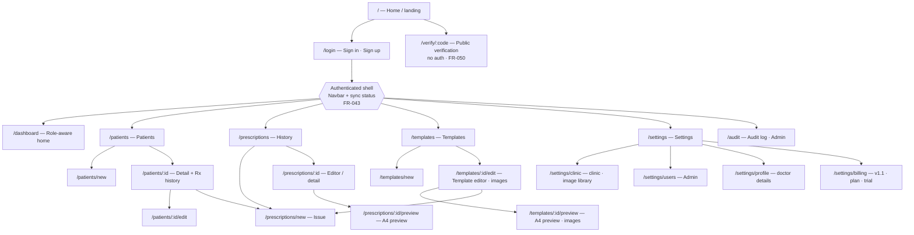
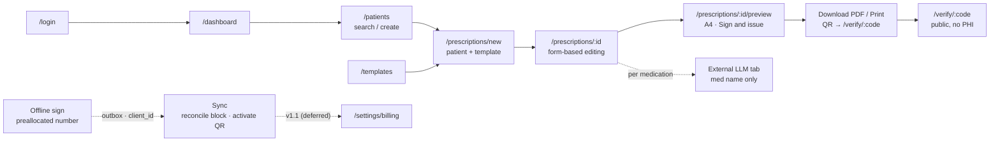

# PersonaSanus — Sitemap

| Field | Value |
|---|---|
| Source | `context/PRD.md` (Draft v0.8 — 2026-11-12) |
| Product | PersonaSanus — prescription generator for doctors (Ecuador, `es-EC`) |
| Platforms | Desktop (macOS, Windows) offline-first + Web (Chromium) — same routes, same UX |
| Router | Dioxus 0.7.1 `router` — single `Route` enum, `#[layout(Navbar)]` for authenticated shell |
| Status key | ✅ Implemented · 🟡 Partial · ⬜ Planned (PRD target) |

> Scope note: v1 = multi-user clinic (doctors + nursing/secretary staff, shared patients and templates), prescriptions only. No EHR, clinical/medical billing, diagnosis support, or patient app — no routes for those. Subscription billing (3-month trial, $5/month or $50/year via **PayPhone Tokenization**, `https://docs.payphone.app/tokenizacion`) is **deferred to v1.1**: `/settings/billing` has no v1 surface, but the route stays reserved. The image library is 1 image per clinic in v1 (5 in v1.1 with billing), 10 MB each, surfaced in clinic settings and the template editor.

## 1. Route map

### 1.1 Public (no auth)

| Route | Name | Roles | PRD | Status | Purpose |
|---|---|---|---|---|---|
| `/` | Home | Public verifier, unauthenticated visitor | §7 | ✅ | Landing; entry to `/login` and explanation of `/verify/:code`. No authenticated-user redirect yet (⬜). |
| `/login` | AuthPage | All staff (pre-auth) | §4 flow 1, §7 | ✅ | Sign in / sign up (Diesel-backed auth module). MFA step for doctors/administrators and device registration for desktop/web clients (`devices`, §9) are M3 and ⬜. |
| `/verify/:code` | Public verification | Public verifier (no account) | §3, §4 flow 4, §5.6 FR-050, FR-033/034 | ⬜ | Scan QR target `https://<domain>/verify/{code}`. Shows "Receta auténtica — issued by Dr. …, date …, No. …" + status (`valid` / `voided` / `superseded` / `not found`). No PHI. Rate-limited per IP. Also supports re-typing the printed verification code (FR-034). Only the path form is routed; Dioxus does not match `#/verify/:code`. |

### 1.2 Authenticated shell

All routes below sit under `#[layout(Navbar)]`: persistent nav (Dashboard, Patients, Prescriptions, Templates, Settings), session/role context, and sync indicators — `online / offline / syncing / pending uploads (count)` (FR-043). Permissions enforced server-side in the authorized service layer, never client-only (§3). Signed/published prescriptions are immutable everywhere below.

| Route | Name | Roles | PRD | Status | Purpose |
|---|---|---|---|---|---|
| `/dashboard` | Dashboard | Administrator, Doctor, Nursing, Secretary | §7 (base) | 🟡 | Implemented: auth-checked page that redirects signed-out users to `/login` and shows the session identity. ⬜ Role-aware content: recent prescriptions, drafts, pending sync (desktop), quick actions (New prescription, New patient, New template). |
| `/patients` | Patients — list | Doctor, Nursing, Secretary, Administrator | §5.1 FR-001/003 | ✅ | Search by name and cédula; list scoped by `clinic_id`. Entry to create/detail. |
| `/patients/new` | Patients — create | Doctor, Nursing, Secretary | FR-001/002 | ✅ | Create patient (names, cédula, age/birth date, sex, phone, notes). Deduplication warning on cédula / likely duplicate. |
| `/patients/:id` | Patient detail | Doctor, Nursing, Secretary (role-filtered); Administrator (read-only) | FR-001/003, §4 flow 5 | 🟡 | Demographics, edit/delete actions, *New prescription*, and the prescription history link are implemented. Actions: *New prescription*, *Edit* (not for the read-only Administrator). |
| `/patients/:id/edit` | Patient edit | Doctor, Nursing, Secretary | FR-001 | ✅ | Update patient fields. Audited (§6 sensitive-read audit). |
| `/prescriptions` | Prescriptions — history | Doctor (own), Nursing, Secretary (reprint), Administrator | §4 flow 5, FR-042 | 🟡 | Search/filter history by patient, date, status (`draft → signed → superseded/voided`, FR-013). *Download PDF* / *Print* regenerates the same content from the final versioned document with `printpdf` (same content, not byte-identical across renderer versions). Desktop: only ≤ 30 days in local cache; older rows show on-demand regeneration. |
| `/prescriptions/new` | Issue prescription | Doctor, Nursing (draft only) | §4 flows 1–2, FR-010 | ✅ | Create from `?patient_id=` + `?template_id=`. Prefills variables, medications, diagnosis. Query params optional — patient/template pickers shown when absent. |
| `/prescriptions/:id` | Prescription editor / detail | Doctor (own; sign), Nursing (draft fields only), Secretary (read + reprint only) | FR-010–014, §5.3 | 🟡 | Form-based editing over the A4 template (no rich text — D-21). `draft`: editable. `signed`: locked, read-only with *Download PDF*, *Print*, *Share*, *Void* (reason required), *Supersede* (new version referencing previous). Per-medication *Explain with LLM* (FR-012, external — §3 below). |
| `/prescriptions/:id/preview` | A4 preview | Same as `/prescriptions/:id` | FR-022, FR-030–034 | ✅ | True-scale A4 (210×297 mm) 1:1 preview; the browser projection of the same layout model `printpdf` renders. Actions: *Sign and issue* (from draft), *Download PDF* (`GET /api/prescriptions/:id/pdf`), *Print* (opens the rendered PDF in the system viewer; desktop renders locally), *Share* (web). Filename `{PatientName}-receta-{DD-MM-AAAA}-{DoctorName}.pdf` via `Content-Disposition` (FR-032, `es-EC`). QR + readable verification code in header/footer (FR-033/034). A provisional offline PDF shows `PENDIENTE DE SINCRONIZACIÓN` and a placeholder QR; the active QR appears only after sync (FR-043). |
| `/templates` | Templates — list | Doctor (own + clinic master), Administrator (master) | FR-020/024 | ✅ | List per-doctor templates and clinic master templates; status and current version. Actions: *New template*, *Use for prescription*. |
| `/templates/new` | Template create | Doctor, Administrator | §4 flow 3, FR-020 | ✅ | Create template: letterhead (clinic logo via `asset_id`, doctor/clinic details, colors) + body + footer (printed signature line, QR, contact). Clinics can insert the 1 library image (v1 quota; 5 in v1.1). No signature or stamp images (D-06). |
| `/templates/:id/edit` | Template editor | Owner doctor; Administrator for master | FR-020/021/023, FR-080–085 | ✅ | Form-based template editor (no rich text — D-21): letterhead fields, body text, footer fields, variable insertion, image slots, medication blocks. Insert images from the clinic library; the upload prompt appears when the v1 quota (1 image) blocks an upload. Variables: `patient.{name,national_id,age}`, `doctor.{name,specialty,national_id,contact}`, `clinic.{name,address,phone}`, `prescription.{number,date,diagnosis}`, `medications[]`. Unknown variables warn pre-signing. Stored as versioned `doc_json` built from form fields, never HTML. *Publish* pins every referenced `asset_id` and creates an immutable version (FR-024). |
| `/templates/:id/preview` | Template A4 preview | Owner doctor, Administrator | FR-022 | ✅ | True-scale A4 preview with sample variable values, repeated header/footer, margins/page breaks, and the pinned images before publishing. |
| `/settings` | Settings — index | All authenticated | §3, §5.5 | ⬜ | Hub linking clinic, users, profile, and (Administrator, v1.1) billing. Redirects to `/settings/profile` for non-admin roles. |
| `/settings/clinic` | Clinic settings | Administrator | §6 `clinics`, FR-042, FR-080–085 | ✅ | Clinic name/address/phone/logo, timezone, `llm_url_template`, local retention days (default 30). Image library: upload/delete 1 image (10 MB; 5 only in v1.1), quota/usage, clinic logo (does not consume the slot). |
| `/settings/users` | Users & roles | Administrator | §3, §6 `profiles`/`clinic_members` | ⬜ | Invite/manage users, assign roles (Administrator/Doctor/Nursing/Secretary), revoke access, manage registered devices (`devices` + `sessions.device_id`, §9). |
| `/settings/profile` | My profile | Doctor, all staff | §6 `doctors` | ⬜ | Display name, specialty, license no. (`license_no`), cédula (`national_id`), phone/email. No signature/stamp asset (D-06). Doctors: default template and branding. |
| `/settings/billing` (v1.1) | Subscription & billing | Administrator | §5.7 FR-060–072, §5.8 FR-080–085, §6 `plans`/`tax_rates`/`payment_methods`/`subscriptions`/`payment_transactions` | ⬜ v1.1 | Not in v1. Trial/status (`trialing`/`active`/`past_due`/`locked`/`canceled`), trial end, next charge, plan picker ($5 monthly / $50 yearly), consent + redirect to the PayPhone payment button (Visa/Mastercard), saved card-token status, transaction history, cancel/reactivate, image-library availability and usage (5 `active`/`past_due`, 1 `trialing`/`locked`, 0 `canceled`). Stores the `ctoken` after consent; later charges use the token; shows the 7-day grace before sync locks. Never blocks clinical work. |
| `/audit` | Audit log | Administrator | §3, §6 `audit_log`, §8 | ⬜ | Actor/action/entity audit trail, sensitive-read log (who/when/what on patients/prescriptions), verification log (FR-050). Retained 5 years, append-only (§8). |

### 1.3 Non-routes (actions, external, print)

| Surface | Trigger | PRD | Notes |
|---|---|---|---|
| Explain with LLM | *Explain with LLM* link per medication line in `/prescriptions/:id` | FR-012, §4 flow 6 | **Not a route.** Opens external LLM page in a new tab via `clinics.llm_url_template` (e.g. `https://chat.openai.com/?q={med}`) with medication name only — never PHI; app never sends data itself. Shows disclaimer. |
| PDF download / print / share | Actions on `/prescriptions/:id/preview` and `/prescriptions` | FR-030/031 | ✅ **Not a page.** `GET /api/prescriptions/:id/pdf` streams the `printpdf` render as `application/pdf` with a sanitized `Content-Disposition` filename; *Print* opens it in the system viewer; Web Share on web. Desktop calls the same renderer in-process and writes the file locally (offline). No PDF is stored. |
| Image upload / delete | Upload from `/settings/clinic` (Administrator) or `/templates/:id/edit` (Doctor, own); delete from the library | §5.8 FR-080–085 | **Not a route.** v1 quota: 1 image per clinic, 10 MB, JPEG/PNG only (WebP/SVG rejected), private MinIO bucket + 15-minute signed URLs. A second upload or oversized file is rejected; the logo does not count; deleting an image pinned to a published version or retained prescription is blocked. Uploads are online-only; cached images render offline. The 5/1/0 state tiers and placeholders are v1.1. |
| Sync / outbox status | Navbar indicator + dashboard widget (desktop) | FR-040–043 | Not a page in v1; count of pending uploads links to filtered `/prescriptions?status=pending_sync`. Offline queue uses idempotent `client_id`; the device's remaining number block is shown. `sync_locked` is v1.1 behavior. |
| PayPhone checkout (v1.1) | *Subscribe* / *Renew* on `/settings/billing` | §5.7 FR-063/071 | **Not a route, not in v1.** Server creates the transaction and redirects to the PayPhone payment button/box (Visa/Mastercard) with an HTTPS `responseUrl`; the response returns `ctoken` plus cardholder data, stored in `payment_methods` after consent. No card form in PersonaSanus. |
| PayPhone confirmation (v1.1) | Provider → `responseUrl` (first charge) or `/api/transaction/web` response (renewal) | §5.7 FR-064, §9 | **Not a route, not in v1.** Treated as a hint; the server confirms the charge with PayPhone, records `payment_events`, and applies entitlement idempotently. |
| Renewal / retention jobs | In-process scheduler (single node) | §5.7 FR-061/065/069/072, §7 Jobs | v1: retention trim after `data_grace_ends_at` (on in v1, D-12), session purge, orphan cleanup. v1.1: trial expiry, tokenized charges (`/api/transaction/web`) at `next_charge_at`, dunning retries. |
| Auth API | `/api/auth/*` | README, §7 Backend | Auth module endpoints (`sign-up/email`, `sign-in/email`, `get-session`, `sign-out`) mounted same-origin; not Dioxus routes. |

## 2. Navigation by role

| Destination | Administrator | Doctor | Nursing | Secretary | Public verifier |
|---|:---:|:---:|:---:|:---:|:---:|
| `/` | ✓ | ✓ | ✓ | ✓ | ✓ |
| `/login` | ✓ | ✓ | ✓ | ✓ | — |
| `/verify/:code` | ✓ | ✓ | ✓ | ✓ | ✓ |
| `/dashboard` | ✓ | ✓ | ✓ | ✓ | — |
| `/patients` (+ `/new`, `/:id`, `/:id/edit`) | read | ✓ | ✓ | ✓ | — |
| `/prescriptions` (history) | ✓ | own | ✓ | ✓ reprint | — |
| `/prescriptions/new` | — | ✓ | draft only | — | — |
| `/prescriptions/:id` (editor) | read | own, sign | draft fields | read + reprint | — |
| `/prescriptions/:id/preview` | ✓ | ✓ | draft preview | ✓ | — |
| `/templates` (+ `/new`, `/:id/edit`, `/:id/preview`) | master | own + master | — | — | — |
| Image library (upload/delete) | ✓ clinic | ✓ own | — | — | — |
| `/settings/clinic` | ✓ | — | — | — | — |
| `/settings/users` | ✓ | — | — | — | — |
| `/settings/profile` | ✓ | ✓ | ✓ | ✓ | — |
| `/settings/billing` (v1.1) | ✓ | — | — | — | — |
| `/audit` | ✓ | — | — | — | — |

Rules (§3, FR-013): nursing cannot sign or publish; secretary cannot edit signed clinical content; the Administrator reads clinical history but never signs or edits it; signing locks editing — corrections create a new version via *Supersede* on `/prescriptions/:id`.

## 3. Primary flows across the sitemap

1. **Issue (online)** — `/login` → `/patients` (search/create) → `/prescriptions/new` → `/prescriptions/:id` → `/prescriptions/:id/preview` → *Sign and issue* → *Download PDF* / *Print*. Target < 60 s (§2).
2. **Issue (offline, desktop)** — same routes against local cache; signing consumes a preallocated number and the prescription queues with `pending_sync`; its PDF is provisional (no active QR). On reconnect the sync API uploads with idempotent `client_id`, reconcile the number block, and the final PDF with an active QR is regenerated. Server wins for signed data; only in-progress drafts prompt on conflict.
3. **Personal template** — `/templates/new` → `/templates/:id/edit` (logo, letterhead/footer, variables) → `/templates/:id/preview` → *Publish* (immutable version).
4. **Verification** — QR on PDF → `/verify/:code` → "Receta auténtica" + doctor/date/number + status.
5. **Re-issue history** — `/prescriptions` → *Download PDF* / *Print* (same content from the pinned version, same `printpdf` renderer); desktop rows older than 30 days regenerate on demand.
6. **Explain medication** — `/prescriptions/:id` → external LLM tab (medication name only).
7. **Subscribe / renew (v1.1, not in v1)** — `/settings/billing` → choose $5 monthly / $50 yearly → consent to store a card token → PayPhone payment button/box with a Visa or Mastercard → `ctoken` returned and stored → sync entitlement updates and the local backlog uploads. Each later period is charged with the stored token; a decline gives 7 days of `past_due` with sync, then `locked`. Billing is deferred (PRD D-04, D-14).
8. **Post-trial free use (v1.1)** — trial expires with no plan → `sync_locked` on new server writes → desktop keeps working locally; web is read-only over the first 3 months retained on the server. Not applicable in v1, which has no billing states.
9. **Image upload** — `/settings/clinic` or `/templates/:id/edit` uploads the single v1 library image (10 MB) → server validates and stores it in the private MinIO bucket → the image is inserted into a template → *Publish* pins it to the immutable version. The five-image state tiers are v1.1.

## 4. Current vs. target

Current Dioxus `Route` enum (`src/main.rs`): `/`, `/login`, `/dashboard`, `/patients`, `/patients/new`, `/patients/:id`, `/patients/:id/edit`, `/settings*`, matching the PRD's M0 progress (Diesel-backed auth, roles, authorized service layer, patient CRUD, and Docker Compose deployment implemented). Everything else is the PRD target IA, sequenced by roadmap (§11):

Spec phases (`specs/01`–`13`) are the execution order and may deliver roadmap items earlier than their milestone label.

| Milestone | Sitemap delivered |
|---|---|
| M0 — foundation | `/login` ✅, `/dashboard` ✅ (auth check only; role-aware content ⬜), `/patients*` ✅ (Rx history spec 07), `/settings/users` ✅, roles + authorized service layer ✅, Docker Compose deployment ✅ |
| M1 — forms + PDF | `/templates*`, `/prescriptions/new`, `/prescriptions/:id`, `/prescriptions/:id/preview`, `/verify/:code`, `printpdf` A4 renderer + QR, logo/one-image upload |
| M2 — offline | Same routes on desktop cache/outbox, preallocated number blocks + provisional PDFs, SSE/polling sync indicators, 30-day retention states in `/prescriptions` |
| M3 — hardening | `/audit`, MFA on `/login`, signed installers + auto-update; device registration/revocation ships with spec 04-D, `/settings/clinic` with spec 06-F, and verification rate limiting on `/verify/:code` with spec 09-I |
| M4 — beta release | Retention/export job (on in v1, D-12), session purge, orphan cleanup, runbook, beta telemetry |
| v1.1 — billing (deferred) | `/settings/billing`, trial + `sync_locked` state in the shell, PayPhone Tokenization (payment button, `ctoken`, renewals), renewal/dunning jobs, image library (5/1 tiers × 10 MB), `tax_rates`-based IVA snapshot, quota + signed URLs |

## 5. Conventions

- **Naming:** resource-plural paths (`/patients`, `/prescriptions`, `/templates`); create = `/new`, detail/edit nested under `/:id`. Prescription creation accepts `?patient_id=&template_id=` so patient detail and template list can deep-link in.
- **No PHI in URLs:** only opaque ids and the verification `code` (FR-033, §9). Never names, cédulas, diagnoses, or medications in paths/query — the LLM link carries the medication name to the external site only on explicit click.
- **Locale:** all labels/dates `es-EC`, `DD-MM-AAAA`, 24-hour time (§8). `receta` and `cédula` keep Ecuador Spanish spelling.
- **Money (v1.1):** billing is USD, displayed `es-EC`; API amounts are integer cents (`$5 = 500`, `$50 = 5000`), tax-inclusive with the IVA split computed from `tax_rates` (15% seeded) and snapshotted per transaction. Never send cents as floats. No billing surface ships in v1.
- **Billing access (v1.1):** only the Administrator can open `/settings/billing` or start checkout; other roles see status/`sync_locked` but cannot change the plan. No card data is ever stored by PersonaSanus — the card is entered on PayPhone's payment button, and only the `ctoken` plus cardholder data are stored after consent.
- **Images:** v1 allows 1 library image per clinic (10 MB); v1.1 adds 5 for `active`/`past_due`, 1 for `trialing`/`locked`, 0 for `canceled`. JPEG/PNG only (WebP/SVG rejected); private MinIO bucket with 15-minute signed URLs; no PHI in object keys or URLs; the clinic logo does not consume the quota, and no signature/stamp images exist (PRD D-06). v1.1 `canceled` soft-deletes and renders placeholders.
- **Deep links:** QR encodes the absolute `/verify/{code}` URL; the typed code uses the same `/verify/:code` path. There is no hash form.
