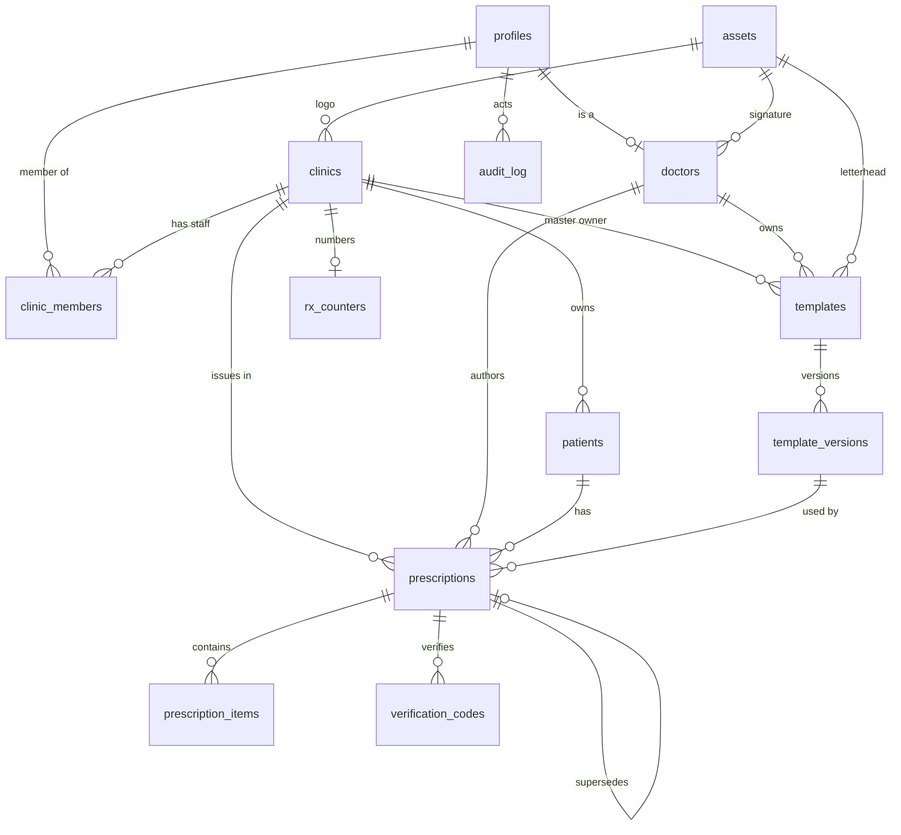

# PersonaSanus — Database Design

| Field | Value |
|---|---|
| Source | `context/PRD.md` (Draft v0.2 — 2026-11-11) §6, `context/sitemap.md` |
| Engine | SQLite (single node), accessed via `sqlx 0.8` (`runtime-tokio`, `sqlite`) |
| Server DB | `app.db` (local) / `/data/app.db` under Docker (`persona-data` volume) |
| Desktop DB | separate local cache SQLite + outbox queue |
| Identity | RustAuth 0.3 owns its own schema (created by `auth.create_schema(None)`) |

## 1. Design decisions

| Decision | Choice | Rationale |
|---|---|---|
| App profile table name | **`profiles`**, not `users` | RustAuth already creates `users` (identity) in the same `app.db`. The PRD §6 `users` table **collides**; renamed to `profiles` and linked via `auth_user_id` → `rustauth.users.id`. This is the one forced deviation from §6. |
| Entity IDs | `TEXT` UUID v7 (time-ordered) | Offline-first: the desktop must mint globally-unique ids without a server round-trip. Matches RustAuth's `TEXT` ids. |
| Timestamps | `TEXT`, UTC ISO-8601/RFC3339 (`2026-11-11T12:34:56Z`) | Matches RustAuth's `created_at` format; sorts lexicographically for range queries (30-day retention, audit). |
| Dates only | `TEXT` `YYYY-MM-DD` | `patients.birth_date`. |
| Enums | `TEXT` + `CHECK` | SQLite has no enum type. |
| Booleans | `INTEGER 0/1` (none currently needed) | — |
| Foreign keys | enabled via `PRAGMA foreign_keys = ON` | **Required per sqlx connection** — `SqliteConnectOptions::foreign_keys(true)` (currently not set in `server.rs`). |
| Immutability | enforced in the authorized service layer | Signed/published prescriptions immutable; no DB triggers (PRD §3). |
| PHI | never in URLs, QR, or `code` | `code` stored as `code_hash` only; plaintext exists only at creation. |

## 2. Table overview

RustAuth owns (do **not** migrate/modify): `users`, `sessions`, `accounts`, `verifications`.

App-owned tables (this design):

| Table | Purpose | PRD ref |
|---|---|---|
| `profiles` | App profile (staff) extending RustAuth identity | §6 `users` (renamed) |
| `clinics` | Clinic settings, branding, retention | §6 `clinics` |
| `clinic_members` | Clinic ↔ staff membership + per-clinic role | §6 `clinic_members` |
| `doctors` | Doctor medical details (license, specialty, signature) | §6 `doctors` |
| `patients` | Patient demographics | §6 `patients` |
| `templates` | Template head record (per-doctor or clinic master) | §6 `templates` |
| `template_versions` | Immutable template versions + editor `doc_json` | §6 `template_versions` |
| `prescriptions` | Prescription head + state machine | §6 `prescriptions` |
| `prescription_items` | Ordered medication lines | §6 `prescription_items` |
| `verification_codes` | Hashed verification code per signed prescription | §6 `verification_codes` |
| `audit_log` | Actor/action/entity trail + sensitive reads | §6 `audit_log` |
| `assets` | Logos/stamps/signatures in object storage | §7, FR-020/030 |
| `rx_counters` | Per-clinic gap-free prescription number | FR-014 |

Desktop-local (not in server DB): `outbox`, `sync_meta`, plus cache mirrors of the above.

## 3. Entity-relationship diagram



RustAuth relationship (not in app schema): `profiles.auth_user_id` → `rustauth.users.id` (1:1).

## 4. Enumerated values

| Field | Values |
|---|---|
| `profiles.role`, `clinic_members.role` | `administrator`, `doctor`, `nursing`, `secretary` |
| `profiles.status` | `active`, `disabled` |
| `patients.sex` | `male`, `female`, `other`, `unspecified` |
| `templates.owner_type` | `doctor`, `clinic` |
| `templates.status`, `template_versions.status` | `draft`, `published`, `archived` |
| `prescriptions.status` | `draft`, `signed`, `superseded`, `voided` |
| `verification_codes.status` | `valid`, `voided`, `superseded` |
| `outbox.operation` | `create_patient`, `update_patient`, `create_template`, `publish_template_version`, `create_prescription`, `upsert_prescription_item`, `sign_prescription`, `void_prescription`, `supersede_prescription`, `create_verification_code` |
| `outbox.status` | `pending`, `failed` |

State machine (FR-013): `draft → signed → superseded/voided`. Signing locks editing; a correction sets the old record to `superseded` and creates a new record with `supersedes_id` → old `id`. Voiding requires `void_reason`.

## 5. Schema (SQLite DDL)

```sql
PRAGMA foreign_keys = ON;

CREATE TABLE profiles (
  id           TEXT PRIMARY KEY,                                      -- UUID v7
  auth_user_id TEXT NOT NULL UNIQUE,                                  -- -> rustauth users.id
  display_name TEXT NOT NULL,
  role         TEXT NOT NULL CHECK (role IN ('administrator','doctor','nursing','secretary')),
  status       TEXT NOT NULL DEFAULT 'active' CHECK (status IN ('active','disabled')),
  created_at   TEXT NOT NULL,
  updated_at   TEXT NOT NULL,
  created_by   TEXT REFERENCES profiles(id)                           -- NULL for bootstrap admin
);

CREATE TABLE assets (
  id           TEXT PRIMARY KEY,
  object_key   TEXT NOT NULL UNIQUE,                                  -- private object-storage key
  owner_type   TEXT NOT NULL CHECK (owner_type IN ('doctor','clinic')),
  owner_id     TEXT NOT NULL,
  content_type TEXT,
  size_bytes   INTEGER,
  sha256       TEXT,
  created_at   TEXT NOT NULL,
  updated_at   TEXT NOT NULL,
  created_by   TEXT REFERENCES profiles(id)
);

CREATE TABLE clinics (
  id               TEXT PRIMARY KEY,
  name             TEXT NOT NULL,
  address          TEXT,
  phone            TEXT,
  logo_asset_id    TEXT REFERENCES assets(id),
  timezone         TEXT NOT NULL DEFAULT 'America/Guayaquil',
  llm_url_template TEXT,                                              -- e.g. https://chat.openai.com/?q={med}
  retention_days   INTEGER NOT NULL DEFAULT 30,
  created_at       TEXT NOT NULL,
  updated_at       TEXT NOT NULL,
  created_by       TEXT REFERENCES profiles(id)
);

CREATE TABLE clinic_members (
  clinic_id  TEXT NOT NULL REFERENCES clinics(id) ON DELETE CASCADE,
  user_id    TEXT NOT NULL REFERENCES profiles(id) ON DELETE CASCADE,
  role       TEXT NOT NULL CHECK (role IN ('administrator','doctor','nursing','secretary')),
  created_at TEXT NOT NULL,
  updated_at TEXT NOT NULL,
  created_by TEXT REFERENCES profiles(id),
  PRIMARY KEY (clinic_id, user_id)
);
CREATE INDEX idx_clinic_members_user ON clinic_members (user_id);

CREATE TABLE doctors (
  id                 TEXT PRIMARY KEY,
  user_id            TEXT NOT NULL UNIQUE REFERENCES profiles(id) ON DELETE CASCADE,
  specialty          TEXT,
  license_no         TEXT,
  signature_asset_id TEXT REFERENCES assets(id),
  phone              TEXT,
  email              TEXT,
  created_at         TEXT NOT NULL,
  updated_at         TEXT NOT NULL,
  created_by         TEXT REFERENCES profiles(id)
);

CREATE TABLE patients (
  id          TEXT PRIMARY KEY,
  clinic_id   TEXT NOT NULL REFERENCES clinics(id),
  full_name   TEXT NOT NULL,
  national_id TEXT,                                                   -- 10-digit cédula
  birth_date  TEXT,                                                   -- YYYY-MM-DD
  sex         TEXT CHECK (sex IN ('male','female','other','unspecified')),
  phone       TEXT,
  notes       TEXT,
  deleted_at  TEXT,                                                   -- logical delete (ARCO)
  created_at  TEXT NOT NULL,
  updated_at  TEXT NOT NULL,
  created_by  TEXT REFERENCES profiles(id)
);
CREATE UNIQUE INDEX uq_patients_national_id
  ON patients (clinic_id, national_id)
  WHERE national_id IS NOT NULL AND deleted_at IS NULL;               -- FR-002 dedup
CREATE INDEX idx_patients_clinic_name ON patients (clinic_id, full_name);

CREATE TABLE templates (
  id                TEXT PRIMARY KEY,
  owner_type        TEXT NOT NULL CHECK (owner_type IN ('doctor','clinic')),
  owner_id          TEXT NOT NULL,                                    -- doctors.id or clinics.id
  name              TEXT NOT NULL,
  current_version_id TEXT REFERENCES template_versions(id),           -- set on publish
  status            TEXT NOT NULL DEFAULT 'draft' CHECK (status IN ('draft','published','archived')),
  created_at        TEXT NOT NULL,
  updated_at        TEXT NOT NULL,
  created_by        TEXT REFERENCES profiles(id)
);
CREATE INDEX idx_templates_owner ON templates (owner_type, owner_id);

CREATE TABLE template_versions (
  id             TEXT PRIMARY KEY,
  template_id    TEXT NOT NULL REFERENCES templates(id) ON DELETE CASCADE,
  version_no     INTEGER NOT NULL,
  doc_json       TEXT NOT NULL,                                       -- editor JSON, sanitized (never raw HTML)
  variables_spec TEXT NOT NULL,                                       -- JSON: known variables
  theme          TEXT,                                                -- JSON: colors/fonts/margins
  status         TEXT NOT NULL DEFAULT 'draft' CHECK (status IN ('draft','published','archived')),
  created_at     TEXT NOT NULL,
  updated_at     TEXT NOT NULL,
  created_by     TEXT REFERENCES profiles(id),
  UNIQUE (template_id, version_no)
);

CREATE TABLE prescriptions (
  id                  TEXT PRIMARY KEY,
  patient_id          TEXT NOT NULL REFERENCES patients(id),
  doctor_id           TEXT NOT NULL REFERENCES doctors(id),
  clinic_id           TEXT NOT NULL REFERENCES clinics(id),
  template_version_id TEXT REFERENCES template_versions(id),
  status              TEXT NOT NULL DEFAULT 'draft' CHECK (status IN ('draft','signed','superseded','voided')),
  rx_number           INTEGER,                                        -- assigned at signing (FR-014)
  diagnosis           TEXT,
  instructions_json   TEXT,                                           -- general instructions (rich-text JSON)
  signed_at           TEXT,
  voided_at           TEXT,
  void_reason         TEXT,
  client_id           TEXT NOT NULL UNIQUE,                           -- idempotency (FR-041)
  supersedes_id       TEXT REFERENCES prescriptions(id),              -- points at the version this replaces
  created_at          TEXT NOT NULL,
  updated_at          TEXT NOT NULL,
  created_by          TEXT REFERENCES profiles(id)
);
CREATE UNIQUE INDEX uq_prescriptions_rx
  ON prescriptions (clinic_id, rx_number)
  WHERE rx_number IS NOT NULL;                                        -- gap-free per clinic
CREATE INDEX idx_prescriptions_patient ON prescriptions (patient_id, created_at);
CREATE INDEX idx_prescriptions_doctor  ON prescriptions (doctor_id, created_at);
CREATE INDEX idx_prescriptions_status  ON prescriptions (clinic_id, status, created_at);

CREATE TABLE prescription_items (
  id              TEXT PRIMARY KEY,
  prescription_id TEXT NOT NULL REFERENCES prescriptions(id) ON DELETE CASCADE,
  position        INTEGER NOT NULL,                                   -- draggable order
  med_name        TEXT NOT NULL,                                      -- free text, no drug DB
  dose            TEXT,
  route           TEXT,
  frequency       TEXT,
  duration        TEXT,
  quantity        TEXT,
  notes           TEXT,
  created_at      TEXT NOT NULL,
  updated_at      TEXT NOT NULL,
  created_by      TEXT REFERENCES profiles(id),
  UNIQUE (prescription_id, position)
);

CREATE TABLE verification_codes (
  id              TEXT PRIMARY KEY,
  prescription_id TEXT NOT NULL UNIQUE REFERENCES prescriptions(id) ON DELETE CASCADE,
  code_hash       TEXT NOT NULL UNIQUE,                               -- plaintext only at creation (QR)
  status          TEXT NOT NULL DEFAULT 'valid' CHECK (status IN ('valid','voided','superseded')),
  created_at      TEXT NOT NULL,
  updated_at      TEXT NOT NULL,
  created_by      TEXT REFERENCES profiles(id)
);

CREATE TABLE audit_log (
  id            TEXT PRIMARY KEY,                                     -- append-only; no updated_at
  actor_id      TEXT REFERENCES profiles(id),
  action        TEXT NOT NULL,                                        -- e.g. sign_prescription, sensitive_read
  entity        TEXT NOT NULL,                                        -- e.g. patient, prescription
  entity_id     TEXT NOT NULL,
  metadata_json TEXT,
  at            TEXT NOT NULL
);
CREATE INDEX idx_audit_entity ON audit_log (entity, entity_id);
CREATE INDEX idx_audit_actor  ON audit_log (actor_id, at);
CREATE INDEX idx_audit_at     ON audit_log (at);

CREATE TABLE rx_counters (
  clinic_id       TEXT PRIMARY KEY REFERENCES clinics(id) ON DELETE CASCADE,
  last_rx_number  INTEGER NOT NULL DEFAULT 0
);
```

## 6. Constraints & invariants

- **Gap-free `rx_number` (FR-014):** assigned in a single transaction at signing:
  `UPDATE rx_counters SET last_rx_number = last_rx_number + 1 WHERE clinic_id = ?` → read back → write into `prescriptions.rx_number`. The `uq_prescriptions_rx` unique index makes double-assignment fail loudly.
- **Idempotency (FR-041):** `prescriptions.client_id` is client-generated and `UNIQUE`. A replayed upload matches on `client_id` and is a no-op/return of the existing row — never a duplicate.
- **Immutable signed data (FR-013):** no UPDATE path for a `signed` prescription except the `void`/`supersede` transitions. Enforced in the service layer; the audit row and new version carry the history.
- **Verification status:** `verification_codes.status` mirrors the prescription: `signed → valid`, `voided → voided`, `superseded → superseded` (updated in the same transaction as the prescription transition). Public result `not found` = no matching `code_hash` row (FR-050).
- **Soft delete (ARCO):** `patients.deleted_at` for logical deletion; hard delete only when no retention obligation applies (§9).

## 7. Desktop local schema (offline-first, FR-040–043)

The desktop keeps a **separate** SQLite database. It mirrors a read cache of server tables (same column shape) plus these two local-only tables:

```sql
CREATE TABLE outbox (
  id            TEXT PRIMARY KEY,                                    -- = client_id (UUID v7)
  operation     TEXT NOT NULL CHECK (operation IN (
                  'create_patient','update_patient','create_template',
                  'publish_template_version','create_prescription',
                  'upsert_prescription_item','sign_prescription',
                  'void_prescription','supersede_prescription',
                  'create_verification_code')),
  entity_type   TEXT NOT NULL,
  entity_id     TEXT NOT NULL,
  payload_json  TEXT NOT NULL,
  status        TEXT NOT NULL DEFAULT 'pending' CHECK (status IN ('pending','failed')),
  attempts      INTEGER NOT NULL DEFAULT 0,
  next_retry_at TEXT,
  last_error    TEXT,
  created_at    TEXT NOT NULL,
  updated_at    TEXT NOT NULL
);

CREATE TABLE sync_meta (
  key        TEXT PRIMARY KEY,                                       -- e.g. last_synced_at, server_generation
  value      TEXT NOT NULL,
  updated_at TEXT NOT NULL
);
```

- **Retention (FR-042):** cache evicts prescriptions older than `clinics.retention_days` (default 30). Eviction removes only local rows, never server data; re-download on demand.
- **`pending_sync` is client-derived**, not a server column: a prescription whose sign/upload still sits in `outbox` renders as `pending_sync` (FR-043, `/prescriptions?status=pending_sync`). Its PDF carries `PENDIENTE DE SINCRONIZACIÓN` and the QR is inactive until the upload succeeds.
- **Conflict rule (PRD §4 flow 2):** server wins for signed data; only an in-progress draft prompts for a choice.

## 8. Migrations

- RustAuth schema: managed by `auth.create_schema(None)`; app migrations must **not** touch it.
- App schema: `sqlx` migrations under `persona-sanus/migrations/` (new directory), applied with `sqlx::migrate!()` on startup.
- `migrations/rustauth` already reserved for RustAuth (see `rustauth.toml`).

## 9. Open decisions / flags

- **`users` → `profiles` rename** is the only change to the PRD §6 table list; forced by the RustAuth `users` collision. Confirm before writing migrations.
- **`assets` table** added (not in §6) — §7 references `asset_id` (logos/stamps) with signed URLs; the table tracks object keys/ownership.
- **`rx_counters` table** added (not in §6) — needed for the transactional gap-free number (FR-014).
- **Registered desktop devices (§9)** and **MFA** are deferred to M3; not modeled here (may land in RustAuth or a `devices` table — confirm with counsel/roadmap).
- **Audit retention** (initial 5 years) and **rate-limiting on `/verify/:code`** confirmed with counsel before M3 (PRD §8/§9).

*Note: existing `server.rs` connects with `create_if_missing(true)` but does not enable foreign keys — `SqliteConnectOptions::foreign_keys(true)` must be added when app tables land.*
