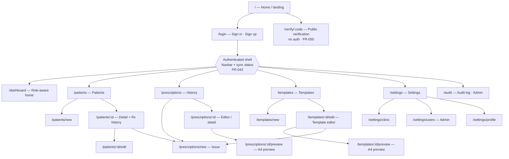
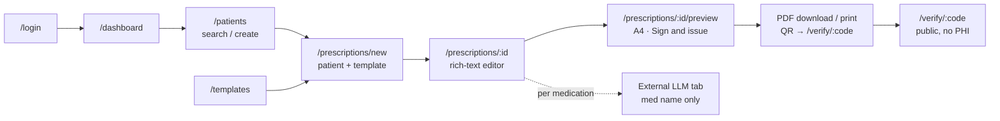

# PersonaSanus — Sitemap

| Field | Value |
|---|---|
| Source | `context/PRD.md` (Draft v0.2 — 2026-11-11) |
| Product | PersonaSanus — prescription generator for doctors (Ecuador, `es-EC`) |
| Platforms | Desktop (macOS, Windows) offline-first + Web (Chromium) — same routes, same UX |
| Router | Dioxus 0.7.1 `router` — single `Route` enum, `#[layout(Navbar)]` for authenticated shell |
| Status key | ✅ Implemented · 🟡 Partial · ⬜ Planned (PRD target) |

> Scope note: v1 = multi-user clinic (doctors + nursing/secretary staff, shared patients and templates), prescriptions only. No EHR, billing, diagnosis support, or patient app — no routes for those.

## 1. Route map

### 1.1 Public (no auth)

| Route | Name | Roles | PRD | Status | Purpose |
|---|---|---|---|---|---|
| `/` | Home | Public verifier, unauthenticated visitor | §7 | ✅ | Landing; entry to `/login` and explanation of `/verify/:code`. Authenticated users redirect to `/dashboard`. |
| `/login` | AuthPage | All staff (pre-auth) | §4 flow 1, §7 | ✅ | Sign in / sign up (RustAuth). MFA step for doctors/administrators (§9). |
| `/verify/:code` | Public verification | Public verifier (no account) | §3, §4 flow 4, §5.6 FR-050, FR-033/034 | ⬜ | Scan QR target `https://<domain>/verify/{code}`. Shows "Receta auténtica — issued by Dr. …, date …, No. …" + hash + status (`valid` / `voided` / `superseded` / `not found`). No PHI. Rate-limited per IP. Also supports re-typing the printed verification code (FR-034). Hash form `#/verify/:code` noted in §3 must resolve to same view. |

### 1.2 Authenticated shell

All routes below sit under `#[layout(Navbar)]`: persistent nav (Dashboard, Patients, Prescriptions, Templates, Settings), session/role context, and sync indicators — `online / offline / syncing / pending uploads (count)` (FR-043). Permissions enforced server-side in the authorized service layer, never client-only (§3). Signed/published prescriptions are immutable everywhere below.

| Route | Name | Roles | PRD | Status | Purpose |
|---|---|---|---|---|---|
| `/dashboard` | Dashboard | Administrator, Doctor, Nursing, Secretary | §7 (base) | ✅ | Role-aware home: recent prescriptions, drafts, pending sync (desktop), quick actions (New prescription, New patient, New template). |
| `/patients` | Patients — list | Doctor, Nursing, Secretary, Administrator | §5.1 FR-001/003 | ⬜ | Search by name and cédula; list scoped by `clinic_id`. Entry to create/detail. |
| `/patients/new` | Patients — create | Doctor, Nursing, Secretary | FR-001/002 | ⬜ | Create patient (names, cédula, age/birth date, sex, phone, notes). Deduplication warning on cédula / likely duplicate. |
| `/patients/:id` | Patient detail | Doctor, Nursing, Secretary (role-filtered) | FR-001/003, §4 flow 5 | ⬜ | Patient demographics + prescription history (authorized roles only). Actions: *New prescription*, *Edit*. |
| `/patients/:id/edit` | Patient edit | Doctor, Nursing, Secretary | FR-001 | ⬜ | Update patient fields. Audited (§6 sensitive-read audit). |
| `/prescriptions` | Prescriptions — history | Doctor (own), Nursing, Secretary (reprint), Administrator | §4 flow 5, FR-042 | ⬜ | Search/filter history by patient, date, status (`draft → signed → superseded/voided`, FR-013). *Download PDF* regenerates identical PDF from final versioned document. Desktop: only ≤ 30 days in local cache; older rows show on-demand *Download*. |
| `/prescriptions/new` | Issue prescription | Doctor, Nursing (draft only) | §4 flows 1–2, FR-010 | ⬜ | Create from `?patient_id=` + `?template_id=`. Prefills variables, medications, diagnosis. Query params optional — patient/template pickers shown when absent. |
| `/prescriptions/:id` | Prescription editor / detail | Doctor (own; sign), Nursing (draft fields only), Secretary (read + reprint only) | FR-010–014, §5.3 | ⬜ | Rich-text editor over A4 template (§2). `draft`: editable. `signed`: locked, read-only with *Download / Print / Share*, *Void* (reason required), *Supersede* (new version referencing previous). Per-medication *Explain with LLM* (FR-012, external — §3 below). |
| `/prescriptions/:id/preview` | A4 preview / print view | Same as `/prescriptions/:id` | FR-022, FR-030–034 | ⬜ | True-scale A4 (210×297 mm) 1:1 rendering; the single HTML/CSS source for Chromium `print-to-PDF`. Actions: *Sign and issue* (from draft), Download `.pdf`, Print, Share (web). Filename `{PatientName}-receta-{DD-MM-AAAA}-{DoctorName}.pdf` (FR-032, `es-EC`). QR + readable verification code in header/footer (FR-033/034). Offline-signed PDFs carry `PENDIENTE DE SINCRONIZACIÓN` marker; QR activates only after sync (FR-043). |
| `/templates` | Templates — list | Doctor (own + clinic master), Administrator (master) | FR-020/024 | ⬜ | List per-doctor templates and clinic master templates; status and current version. Actions: *New template*, *Use for prescription*. |
| `/templates/new` | Template create | Doctor, Administrator | §4 flow 3, FR-020 | ⬜ | Create template: letterhead (logo/stamp via `asset_id` upload, doctor/clinic details, colors) + body + footer (signature/stamp, QR, contact). |
| `/templates/:id/edit` | Template editor | Owner doctor; Administrator for master | FR-020/021/023 | ⬜ | WYSIWYG editor (bold/italic/underline, lists, tables, alignment, headings, variable insertion, medication blocks). Variables: `patient.{name,national_id,age}`, `doctor.{name,specialty,national_id,contact}`, `clinic.{name,address,phone}`, `prescription.{number,date,diagnosis}`, `medications[]`. Unknown variables warn pre-signing. Stored as versioned `doc_json`, never unsanitized HTML. *Publish* creates immutable version (FR-024). |
| `/templates/:id/preview` | Template A4 preview | Owner doctor, Administrator | FR-022 | ⬜ | True-scale A4 preview with sample variable values, repeated header/footer, margins/page breaks before publishing. |
| `/settings` | Settings — index | All authenticated | §3, §5.5 | ⬜ | Hub linking clinic, users, and profile settings. Redirects to `/settings/profile` for non-admin roles. |
| `/settings/clinic` | Clinic settings | Administrator | §6 `clinics`, FR-042 | ⬜ | Clinic name/address/phone/logo, timezone, `llm_url_template`, local retention days (default 30). |
| `/settings/users` | Users & roles | Administrator | §3, §6 `users`/`clinic_members` | ⬜ | Invite/manage users, assign roles (Administrator/Doctor/Nursing/Secretary), revoke access, manage registered desktop devices (§9). |
| `/settings/profile` | My profile | Doctor, all staff | §6 `doctors` | ⬜ | Display name, specialty, license no. (`license_no`), phone/email, signature/stamp asset. Doctors: default template and branding. |
| `/audit` | Audit log | Administrator | §3, §6 `audit_log`, §8 | ⬜ | Actor/action/entity audit trail, sensitive-read log (who/when/what on patients/prescriptions), verification log (FR-050). Minimum retention to be confirmed with counsel (§8, initial suggestion 5 years). |

### 1.3 Non-routes (actions, external, print)

| Surface | Trigger | PRD | Notes |
|---|---|---|---|
| Explain with LLM | *Explain with LLM* link per medication line in `/prescriptions/:id` | FR-012, §4 flow 6 | **Not a route.** Opens external LLM page in a new tab via `clinics.llm_url_template` (e.g. `https://chat.openai.com/?q={med}`) with medication name only — never PHI; app never sends data itself. Shows disclaimer. |
| PDF download / print / share | Actions on `/prescriptions/:id/preview` and `/prescriptions` | FR-031 | Download `.pdf`, system print dialog, Web Share. No dedicated route; print uses the preview's print CSS. |
| Sync / outbox status | Navbar indicator + dashboard widget (desktop) | FR-040–043 | Not a page in v1; count of pending uploads links to filtered `/prescriptions?status=pending_sync`. Offline queue uses idempotent `client_id`. |
| Auth API | `/api/auth/*` | README, §7 Backend | RustAuth endpoints mounted same-origin; not Dioxus routes. |

## 2. Navigation by role

| Destination | Administrator | Doctor | Nursing | Secretary | Public verifier |
|---|:---:|:---:|:---:|:---:|:---:|
| `/` | ✓ | ✓ | ✓ | ✓ | ✓ |
| `/login` | ✓ | ✓ | ✓ | ✓ | — |
| `/verify/:code` | ✓ | ✓ | ✓ | ✓ | ✓ |
| `/dashboard` | ✓ | ✓ | ✓ | ✓ | — |
| `/patients` (+ `/new`, `/:id`, `/:id/edit`) | ✓ | ✓ | ✓ | ✓ | — |
| `/prescriptions` (history) | ✓ | own | ✓ | ✓ reprint | — |
| `/prescriptions/new` | — | ✓ | draft only | — | — |
| `/prescriptions/:id` (editor) | read | own, sign | draft fields | read + reprint | — |
| `/prescriptions/:id/preview` | ✓ | ✓ | draft preview | ✓ | — |
| `/templates` (+ `/new`, `/:id/edit`, `/:id/preview`) | master | own + master | — | — | — |
| `/settings/clinic` | ✓ | — | — | — | — |
| `/settings/users` | ✓ | — | — | — | — |
| `/settings/profile` | ✓ | ✓ | ✓ | ✓ | — |
| `/audit` | ✓ | — | — | — | — |

Rules (§3, FR-013): nursing cannot sign or publish; secretary cannot edit signed clinical content; signing locks editing — corrections create a new version via *Supersede* on `/prescriptions/:id`.

## 3. Primary flows across the sitemap

1. **Issue (online)** — `/login` → `/patients` (search/create) → `/prescriptions/new` → `/prescriptions/:id` → `/prescriptions/:id/preview` → *Sign and issue* → PDF. Target < 60 s (§2).
2. **Issue (offline, desktop)** — same routes against local cache; prescription queues with `pending_sync`; on reconnect server functions upload with idempotent `client_id`. Server wins for signed data; only in-progress drafts prompt on conflict.
3. **Personal template** — `/templates/new` → `/templates/:id/edit` (logo/stamp, letterhead/footer, variables) → `/templates/:id/preview` → *Publish* (immutable version).
4. **Verification** — QR on PDF → `/verify/:code` → "Receta auténtica" + doctor/date/number + hash.
5. **Re-issue / download history** — `/prescriptions` → *Download PDF* (identical regeneration); desktop rows older than 30 days fetch on demand.
6. **Explain medication** — `/prescriptions/:id` → external LLM tab (medication name only).

## 4. Current vs. target

Current Dioxus `Route` enum (`src/main.rs`): `/`, `/login`, `/dashboard` — all ✅ above, matching the PRD's M0 progress (RustAuth auth + Docker Compose deployment implemented; roles and patient CRUD remain). Everything else is the PRD target IA, sequenced by roadmap (§11):

| Milestone | Sitemap delivered |
|---|---|
| M0 — foundation | `/login` ✅, `/dashboard` ✅, `/patients*`, `/settings/users`, role gating in shell, Docker Compose deployment ✅ |
| M1 — editor + PDF | `/templates*`, `/prescriptions/new`, `/prescriptions/:id`, `/prescriptions/:id/preview`, `/verify/:code`, PDF + QR |
| M2 — offline | Same routes on desktop cache/outbox, sync indicators, 30-day retention states in `/prescriptions` |
| M3 — hardening | `/audit`, `/settings/clinic`, MFA on `/login`, verification rate limiting on `/verify/:code` |

## 5. Conventions

- **Naming:** resource-plural paths (`/patients`, `/prescriptions`, `/templates`); create = `/new`, detail/edit nested under `/:id`. Prescription creation accepts `?patient_id=&template_id=` so patient detail and template list can deep-link in.
- **No PHI in URLs:** only opaque ids and the verification `code` (FR-033, §9). Never names, cédulas, diagnoses, or medications in paths/query — the LLM link carries the medication name to the external site only on explicit click.
- **Locale:** all labels/dates `es-EC`, `DD-MM-AAAA`, 24-hour time (§8). `receta` and `cédula` keep Ecuador Spanish spelling.
- **Deep links:** QR encodes the absolute `/verify/{code}` URL; both `/verify/:code` and `#/verify/:code` forms resolve to the same public page.
